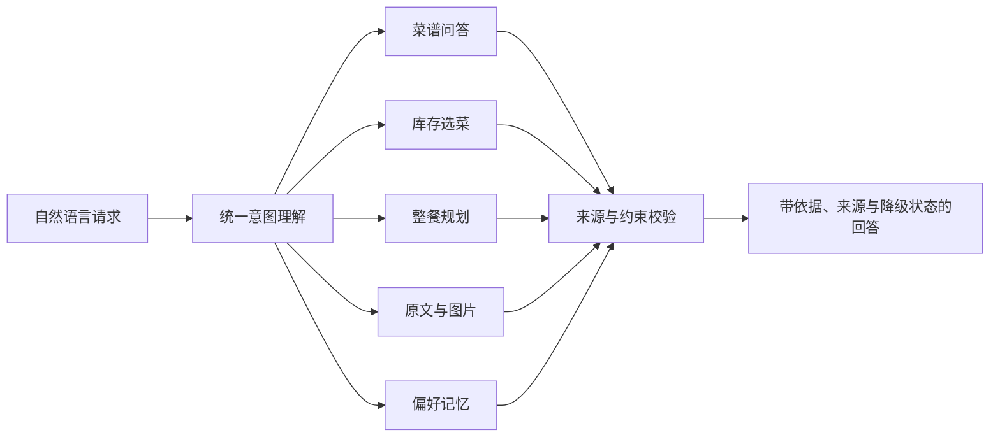
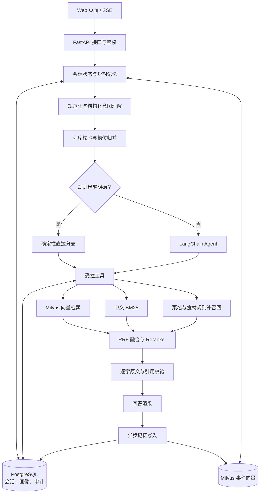
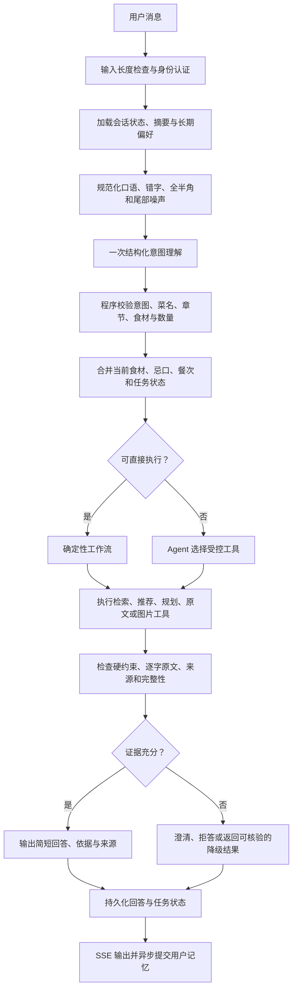
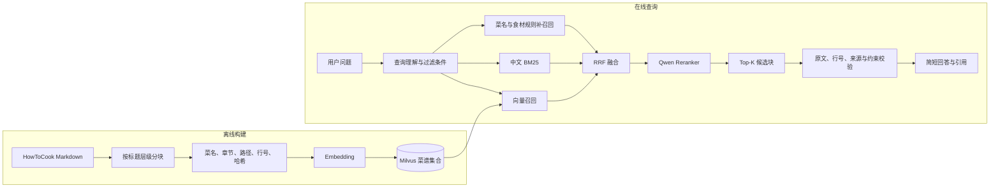
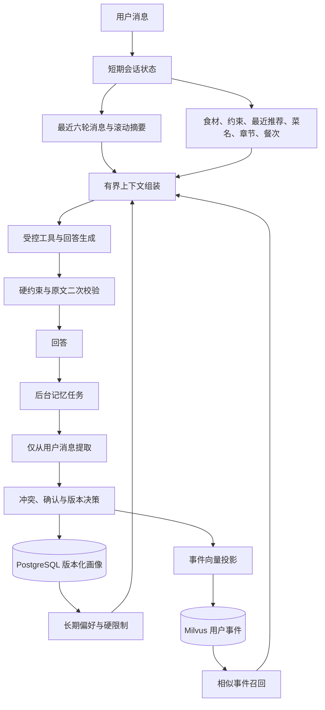
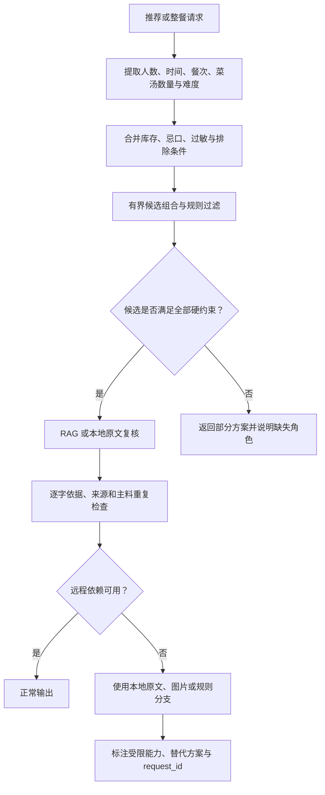
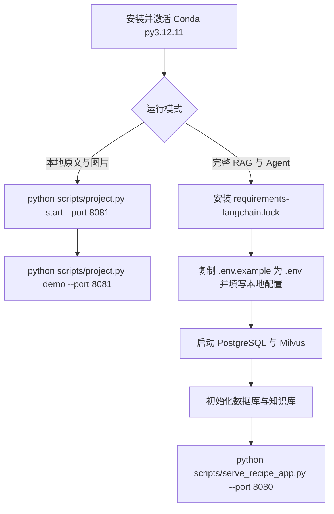

# CookBuddy

> 可追溯菜谱 RAG Agent：模型负责理解与局部工具选择，程序负责状态迁移、事实核验与降级。

CookBuddy 是一个本地运行的菜谱问答与推荐系统。它支持菜谱检索、食材推荐、整餐规划、原文和图片查看、多轮追问以及长期偏好记忆。最终菜谱事实来自受控工具、逐字原文与来源元数据，不让模型自由补写。

## 能力地图



## 系统架构



核心边界：

- Agent 不生产菜谱事实，只负责理解请求和选择受控工具。
- 明确规则优先，避免所有请求都经过模型自由规划。
- 原文、行号、来源和引用元数据由程序生成并复核。
- 依赖失败时返回可验证的原文候选，并明确说明降级原因。

## 请求流程



## RAG 流程



正式知识库当前以 Markdown 菜谱为主。HTML、CSV、TSV、XLSX、PDF 和 DOCX 解析管线用于候选材料，未经复核不会自动发布到活动索引。本地图片按原文引用行、章节和哈希建立来源关联，不作为独立的图像事实来源。

## 记忆流程



记忆边界：

- 人数、时间、当前库存和本次用餐条件只保存在会话中。
- 口味、忌口、过敏等稳定偏好进入长期画像。
- PostgreSQL 是权威数据源，Milvus 只保存用于召回的事件向量。
- 记忆可以影响候选排序，但不能替代菜谱原文和来源证据。

## 推荐与降级



整餐规划不会为了凑齐菜数而放宽硬约束。早餐、午餐、晚餐和夜宵使用独立模板；30 分钟无法满足三菜一汤时，会说明实际数量、缺失角色和预计时间。

## 技术栈

| 模块 | 实现 |
| --- | --- |
| API 与页面 | Python、FastAPI、SSE、HTML/CSS/JavaScript |
| Agent | LangChain `create_agent`、工具 schema、middleware |
| Agent 状态 | LangGraph 运行图与 PostgreSQL checkpoint |
| 主业务编排 | `ChatEngine` 确定性状态机 |
| 向量检索 | Milvus、Qwen Embedding、Qwen Reranker |
| 混合召回 | 向量、中文 BM25、菜名与食材规则补召回、RRF |
| 业务数据 | PostgreSQL、RLS、版本链、审计与持久任务 |
| 本地任务 | SQLite 队列、幂等提交、取消、并发与超时预算 |
| 部署 | Docker Compose、本地 Conda `py3.12.11` |

## 快速开始



本地模式不调用远程模型，只开放目录、逐字原文和来源图片：

```sh
conda activate py3.12.11
python scripts/project.py start --port 8081
python scripts/project.py demo --port 8081
```

完整模式：

```sh
conda activate py3.12.11
python -m pip install -r requirements-langchain.lock
cp .env.example .env

docker compose --env-file .env -f deployment/cookbuddy/compose.yaml up -d
python scripts/cookbuddy_manage.py init
python scripts/serve_recipe_app.py --port 8080
```

访问 <http://127.0.0.1:8080/>。启动前可执行：

```sh
python scripts/project.py check --live
```

## 测试

```sh
conda activate py3.12.11
python -m unittest discover -s tests
```

本次 README 整理前，项目约定环境完整回归结果为：

```text
1088 tests
43 skipped
0 failures
```

前端渲染测试可从 `py3.12.11` 环境运行：

```sh
node --test tests/test_answer_rendering.cjs
```

## 项目结构

```text
app/                   页面与前端渲染
src/                   对话引擎、NLU、Agent、API 与检索
scripts/               服务入口、RAG、推荐、记忆与任务执行
tests/                 后端、状态机、前端与浏览器回归
eval/                  离线评测、消融与验收报告
config/                模型、记忆、餐次与降级配置
deployment/cookbuddy/  Docker Compose 部署文件
migrations/            PostgreSQL 迁移
docs/                  设计、实现与验收记录
设计文档/              产品需求与 Agent 任务书
```

## 文档索引

- [对话改造与长对话验收](docs/dialogue-refactor-20261027.md)
- [意图理解与容错设计](docs/nlu_design.md)
- [记忆系统](docs/memory.md)
- [LangChain 多 Agent](docs/langchain-multi-agent-v1.md)
- [降级路径与餐次菜单](docs/degradation_design.md)
- [运行、检查与演示](docs/project-run-delivery.md)
- [PRD 交付与验收](docs/prd-final-delivery-20261021.md)
- [面试讲解指南](docs/rag-agent-interview-guide.md)
- [产品需求文档](设计文档/PRD_菜谱RAG_Agent.md)

## 仓库与数据边界

本仓库只包含代码、测试、配置解析逻辑、部署文件和文档。以下内容不会进入 Git：

- `.env`、API Key、数据库密码和会话密钥
- `data/`、`output/` 中的菜谱源文件、向量、索引、SQLite、日志和验收截图
- `.venv-*`、Python 缓存、`.pytest_cache`
- `.playwright-*` 调试产物和 `.DS_Store`

因此，克隆仓库后不能只靠当前代码立即获得完整知识库。完整模式需要在本机准备菜谱数据、Embedding、Milvus、PostgreSQL 和模型配置。

## 当前限制

- 项目定位为本地学习与工程验收 MVP，不声明生产 SLA。
- 98.96% 是封存检索题 Hit@5，不是端到端回答准确率。
- 图片 OCR、视觉描述和多种文档解析仍属于受控候选能力。
- 模型、Embedding、Reranker 或 Milvus 不可用时，系统会降级，但可用能力取决于具体任务。
- 回归测试通过不等于任意口语表达、全库事实或跨主机高可用已经验收。
