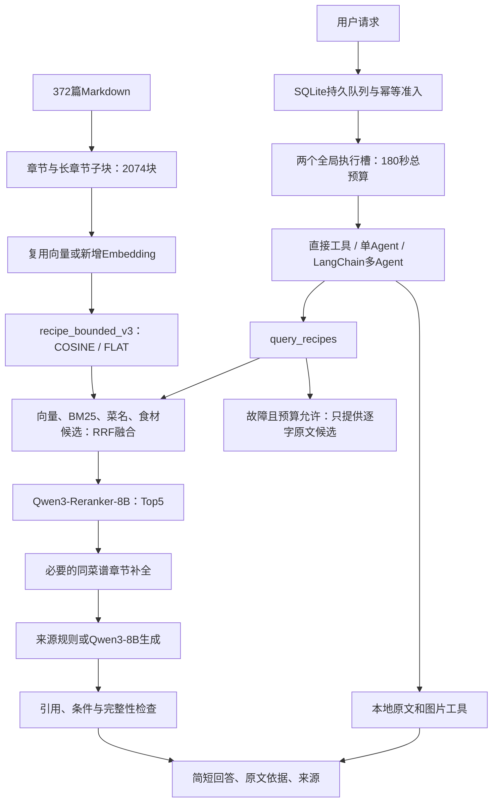

# RAG 与 Agent 工程补齐：实现与测试对应表

日期：2026-10-13。使用 conda `py3.12.11`（Python 3.12.11）。本轮将面试文档里的适用设计落实为代码、开关和可回看的测试记录，同时保留首轮失败，不将补测当成一次全通过。

后续新增的八题质量验收、限制强度检查、章节缺失范围和生成失败原文降级，见[新问题质量验收](quality-batch-v1.md)。该批最终234项测试通过；八题中七题完成预期、一题安全降级，不将降级计作生成回答成功。下文228项是本工程补齐批的历史记录。

再下一批的模型调用耗时、并行复核、总预算预留与库存幻觉防线见[问答耗时优化](qa-latency-v1.md)，最终246项测试通过。三题固定输入对照不是生产延迟保证。

## 1. 当前启用的链路



正式在线模型路径使用统一的准入、有限重试与熔断。历史离线抽取试验保留独立脚本和既有边界。模型自由总结不能覆盖工具的事实结果；生成或复核失败不能伪装成“原文没有答案”。

## 2. 设计如何体现在代码和测试中

| 面试文档中的设计 | 实际实现 | 验证方式／证据 |
|---|---|---|
| 按语义章节分块 | 保留标题层级、原文行号；新版本对过长正文再按完整行拆子块，默认不重叠 | 原有解析测试；新分块全量来源、向量逐条读回核对 |
| 长度、父子块、重叠取舍 | 768个cl100k_base token正文长度代理，父章节／父块／part；通用解析器可设行重叠；不可无损拆的长单行明确拒绝 | `test_ingestion_and_hybrid.py` 的上限、定位、重叠、围栏测试 |
| 元信息与去路径模式 | 菜名、章节、source、行号／页码／文档节点、源哈希；候选解析和版本准备可去掉向量输入中的路径 | 稳定ID、源哈希、去路径输入测试；正式版本仍保留路径，不声称去路径效果提升 |
| PDF、Word与多模态 | 文本PDF提取；扫描PDF经本地渲染与Apple Vision OCR；DOCX段落和表格；已有图片索引、OCR与核对字样查图 | 两个真实本地PDF样本、DOCX结构测试、既有图片测试；OCR保留区域与置信信息，标为待复核 |
| 向量空间一致性 | 模型／维度／服务地址校验、有限数值和非零向量、源哈希与输入文本哈希绑定 | 已有输入检查；新增无效向量不缓存测试；新集合2074条逐条核对 |
| 召回不准的通道补充 | 中文字符／双字和英文词BM25倒排，结合向量、菜名与有限食材规则 | 中文精确词与规则单测、6题真实检索对照 |
| 异构排序融合 | RRF使用通道名次；不直接相加BM25、余弦及Rerank分数 | 重复去重与异构分数尺度测试 |
| Rerank及消融 | 可配置Top K／Top N和重排开关；默认Qwen/Qwen3-Reranker-8B | 纯向量、规则补召回、混合、加／不加重排的真实对照 |
| 上下文和来源检查 | 现有同菜谱补全、逐字引用、库存条件、数量和完整性检查继续使用；新增补全开关 | 全项目回归；新版本真实问答、原文、图片验收 |
| Agent与工作流边界 | 固定RAG封装为工具，Agent选择工具；后端白名单、schema、完整问题和请求范围检查 | 原有Agent单测；新增复合请求范围测试及真实修复补测 |
| LangChain职责隔离 | 协调者、问答专员、原文图片专员；工具去重、委托和实际工具次数上限 | 既有多Agent边界单测、真实三场景与页面复合请求 |
| 独立子任务并行 | 多Agent专员的联合来源工具并行执行原文与图片；复制请求预算上下文 | 双线程屏障测试证明同时进入；真实复合请求成功 |
| 状态持久化 | LangGraph SQLite checkpoint，按请求与专员隔离；并非自动注入旧库存的长期记忆 | 新连接读取checkpoint及不同thread隔离测试，真实多Agent执行记录 |
| 有界准入、持久排队 | SQLite WAL任务队列，原子认领；全局执行槽默认2、未完成任务容量8；IP提交频率限制 | 原子并发准入／多实例认领／频率限制测试；页面1、4、16并发验收 |
| 幂等与重启 | 相同幂等键和问题返回原任务，不同内容409；任务状态和结果持久保存，孤儿任务明确失败 | 队列单测、页面幂等及服务重启测试 |
| 总时间预算与取消 | 从提交开始180秒，包含等待；子阶段继承deadline；协调进程终止整个任务进程组；释放该任务的模型lease | 嵌套预算／进程终止／定向lease释放单测；页面取消与过期测试 |
| 跨进程模型预算 | SQLite保存模型scope的并发lease、RPM与保守输入／输出预算；调用网络时不持有数据库事务 | 共享store、RPM／TPM、到期lease和取消释放测试 |
| 重试与熔断 | 429、可恢复5xx和网络失败有限重试，遵守Retry-After，指数退避加jitter；认证／格式错误不重试；半开探测有lease | 真正的本地HTTP故障服务、socket超时、401、格式错误、熔断恢复测试 |
| 缓存和正确失效 | 问题向量与重排缓存；可选已核验答案缓存绑定完整问题、库版本、代码策略和来源全文哈希 | 版本缓存／无效结果不缓存／库存否定问题不混用测试；全库旧向量与新版复用核对 |
| 降级与备用生成 | 问答故障时仅返回原文候选；可配置备用聊天模型，仍走引用与语义检查；不切换Embedding空间 | 故障降级逐字依据、备用模型与401不切换、预算耗尽不启动备用模型测试；备用模型未做真实线上切换验收 |
| 版本发布与回滚 | 来源清单、增删改计划、独立集合、逐条验收、隔离别名切换和回滚、活动配置原子切换 | 增删改和模型变化单测、真实隔离别名发布／回滚记录；当前启用bounded_v3 |
| 本地访问控制与可观察性 | 可选访问口令、HttpOnly/SameSite cookie、来源和路径白名单；任务和模型阶段指标；HTTP线程有界 | 未授权／错口令／跨源拒绝测试；页面指标、密钥不进入运行数据库检查 |

新增代码主要是 [document_ingestion.py](../scripts/document_ingestion.py)、[prepare_recipe_version.py](../scripts/prepare_recipe_version.py)、[lexical_retrieval.py](../scripts/lexical_retrieval.py)、[service_runtime.py](../scripts/service_runtime.py)、[job_queue.py](../scripts/job_queue.py)、[knowledge_versions.py](../scripts/knowledge_versions.py)。原有问答、工具和LangChain入口直接接入这些能力。

## 3. 入库版本与解析证据

旧版`recipe_all_v1`有2058块。检查发现15个正文超过768代理token；拆分后共2074块，2043块文本不变可复用向量，31块需要新向量。最终启用的`recipe_bounded_v3`又复用了全部2074个已生成向量，并完成每条正文、元信息和向量读回核对。

- [当前版本计划](../data/processed/recipe_versions/bounded_v3/version-plan.json)
- [2074条逐条入库核对](../data/processed/index-lab/recipe_bounded_v3.json)
- [活动版本切换](../data/processed/engineering-acceptance/active-version-change.json)
- [隔离别名发布与回滚](../data/processed/engineering-acceptance/version-switch.json)
- [文本PDF解析](../data/processed/engineering-acceptance/fixtures/text-parsed.json)
- [扫描PDF OCR解析](../data/processed/engineering-acceptance/fixtures/scan-parsed.json)

长度代理不是Qwen精确tokenizer。单行超长、复杂表格合并、复杂PDF版面和OCR数字语义仍需处理；非MD解析结果未直接混入正式配方知识。当前没有音视频数据，不能声称音视频解析已经完成。

新增全库原文工具审计：372个来源逐一读取并逐字核对通过。发现一组同名“陈皮排骨汤”时要求明确来源，不自动合并；完整路径里出现目录菜名时优先确认具体来源，避免把微波炉／蒸箱鸡蛋羹误认为多菜名请求。见[372来源审计](../data/processed/engineering-acceptance/all-source-tools.json)。

## 4. 真实检索与重排对照

固定旧版2058块，6个已定位参考证据的诊断题；同一问题的候选进行加／不加重排比较。参考块清单在 [engineering-cases-v1.json](../data/evaluation/engineering-cases-v1.json)。

| 方案 | Top5证据Recall均值 | MRR | nDCG | 全部参考证据进入Top5的题目比例 |
|---|---:|---:|---:|---:|
| 纯向量 | 0.6667 | 0.4722 | 0.5218 | 0.6667 |
| 向量＋原有规则补召回，按余弦排序 | 0.6667 | 0.4722 | 0.5218 | 0.6667 |
| 混合召回＋RRF | 0.9444 | 0.8889 | 0.8619 | 0.8333 |
| 纯向量＋Rerank | 0.7222 | 0.8333 | 0.7315 | 0.6667 |
| 混合召回＋Rerank | 1.0000 | 1.0000 | 0.9866 | 1.0000 |

这是块级证据排序结果，不是最终回答准确率。题目已经用于工程诊断，不是独立盲测。缓存冷热状态也不统一，因此本轮不据耗时估计重排性能增益。需要增加独立题集、重复测试和更全面的上下文／生成校验消融。

同样6个问题使用独立HNSW集合，对`ef=32/64/128`各测5次。与FLAT Top20的最小集合重合率为0.95；这是近邻结果重合率，不是语义正确率。本机小数据不能证明大规模场景更快。

完整结果：[检索／重排／HNSW对照](../data/processed/engineering-acceptance/retrieval-ablation.json)。正式索引继续使用FLAT。

## 5. 真实Agent对照与发现的问题

三类请求：图片、原文与图片复合请求、事实问答；分别跑直接工具、单Agent和多Agent，共9条首轮记录。首轮8条工具与来源状态符合预期，单Agent复合请求多调用了RAG，并出现校验失败，耗时116.682秒。这条失败保留在 [首轮Agent对照](../data/processed/engineering-acceptance/agent-comparison.json)。

随后对明确只查看原文和图片的请求收紧工具范围，统一菜名／章节恢复，在两个所需来源工具成功后停止规划。真实补测调用两个工具、章节均为“酵头”，一次规划调用、耗时2.55秒，结果completed。见 [补测记录](../data/processed/engineering-acceptance/agent-followup.json)。单次耗时不是平均性能承诺。

多Agent真实图片请求观察到4次规划调用；直接工具为0，单Agent图片为2。多Agent仍是可选模式，尚未证明回答质量比单Agent更高。新版页面的多Agent复合请求也通过，见 [活动版本多Agent验收](../data/processed/engineering-acceptance/active-multi-agent.json)。

## 6. 页面负载、幂等、取消与持久化

使用真实本地API和原文工具，默认2个执行槽、容量8。以下为最后一次负载记录，数值以JSON为准。

| 同时提交数 | 接受 | 429拒绝 | 接受项完成 | 同时执行峰值 |
|---|---:|---:|---:|---:|
| 1 | 1 | 0 | 1 | 1 |
| 4 | 4 | 0 | 4 | 2 |
| 16 | 8 | 8 | 8 | 2 |

幂等键复用、取消状态、重启后结果一致、排队预算过期、API-only与独立worker共享队列执行均通过。每组的P50／P95／P99、排队P95和耗时见 [本地负载测试](../data/processed/engineering-acceptance/local-load-test.json)。

这里测试的是本地原文读取，不是16个远程模型问答同时完成；拒绝的请求不算成功处理吞吐。实际生产配额、跨主机持久队列与集群高可用没有测试。

新版页面五个真实场景——原文、本地图片、原文外链、RAG调料问答、单Agent选图——均通过，并逐字核对引用、检查本地图片存在。见 [应用回归结果](../data/evaluation/app-acceptance-v1/summary.json)。

真实浏览器还验证了多Agent选图、点击取消、取消后重新查询：取消状态可见、开始查询按钮恢复，随后展示三张图片及原文行号；未观察到控制台错误。见[浏览器验收](../data/processed/engineering-acceptance/browser-acceptance.json)、[取消截图](../data/processed/engineering-acceptance/browser-cancel.jpg)、[图片与来源截图](../data/processed/engineering-acceptance/browser-images.jpg)。

## 7. 测试与复现

最终项目228项测试通过，包含新增的解析、混合检索、持久队列、真实HTTP故障服务、预算、取消、缓存、备用生成与checkpoint测试。见[测试记录](../data/processed/engineering-acceptance/unit-tests.json)。

```sh
conda activate py3.12.11
python -m pip install -r requirements-engineering.txt
python -m unittest discover -s tests -q
python scripts/serve_recipe_app.py
```

另一个终端可运行：

```sh
conda activate py3.12.11
python scripts/smoke_recipe_app.py
python scripts/load_test_recipe_app.py
# 检索对照题集固定旧版ID，显式选择旧版，不能混入新版本。
RAG_VERSION='' python scripts/evaluate_engineering.py --part retrieval
python scripts/evaluate_engineering.py --part agents
```

在线对照会调用现有Embedding／Rerank／生成API并消耗额度，保留结果而不覆盖知识库。`load_test_recipe_app.py`启动临时端口和临时任务库，不中断正在使用的8080页面。

解析入口示例：

```sh
python scripts/document_ingestion.py path/to/recipe.pdf --ocr --output data/processed/document-candidates/recipe.json
python scripts/document_ingestion.py path/to/recipe.docx --output data/processed/document-candidates/recipe-word.json
```

扫描PDF依赖本机`pdftoppm`和Apple Vision／Swift；不能将这个OCR入口说成跨平台部署已验证。

开关与默认值：

| 配置 | 默认 | 用途 |
|---|---|---|
| `RAG_RETRIEVAL` | `hybrid` | `vector`可退回向量及原有规则通道 |
| `RAG_AUGMENT` | `1` | `0`关闭菜名与食材规则补召回 |
| `RAG_RERANK` | `1` | `0`做无重排消融；记录明确标为disabled |
| `RAG_CONTEXT_COMPLETION` | `1` | `0`关闭生成前同菜谱补全 |
| `RAG_TOP_K`／`RAG_TOP_N` | `20`／`5` | 候选与初选数量 |
| `RAG_VERSION` | 当前活动配置 | 指定已逐条核对版本，空字符串选旧版 |
| `RECIPE_WORKERS`／`RECIPE_GLOBAL_WORKERS` | `2`／`2` | 当前进程worker数／同库全局执行槽 |
| `RECIPE_QUEUE_CAPACITY` | `8` | 未完成任务上限 |
| `RECIPE_REQUEST_SECONDS` | `180` | 从提交开始的总预算，含排队 |
| `RECIPE_USER_RPM` | `60` | 当前按来源IP限制提交，不是完整多用户账户系统 |
| `RECIPE_MODEL_CONCURRENCY`／`RECIPE_MODEL_RPM` | `2`／`60` | 每个服务地址＋模型scope跨进程配额 |
| `RECIPE_MODEL_TPM` | `60000` | 保守输入字节＋输出上限预算，不是供应商精确计费token |
| `RECIPE_ANSWER_CACHE` | `0` | `1`启用已核验答案缓存；来源或完整问题变化失效 |
| `RECIPE_GENERATION_FALLBACK` | 空 | 可选备用聊天模型；需另验真实模型可用性 |
| `RECIPE_ACCESS_TOKEN` | 空 | 可选本地访问口令，独立于模型密钥 |

这些服务配置在启动前通过环境变量传入；`.env`继续用于模型API配置。必须按实际供应商限额调整，不把工程默认值当成账户额度。任务、模型治理和checkpoint数据库位于忽略提交的`data/runtime/`，不保存API认证头；已有执行记录仍包含问题和来源，属于本地诊断材料。

可分离API与worker：用`RECIPE_WORKERS=0 python scripts/serve_recipe_app.py`启动只接收请求的API，再启`python scripts/job_queue.py`共享同机任务库，由`RECIPE_GLOBAL_WORKERS`限制总执行数。该路径已做真实页面接口验收。当前不是Redis／RabbitMQ的跨主机队列；SQLite WAL不可直接作为网络共享文件系统上的集群队列。

## 8. 明确的验收边界

本轮新增与原有测试共同验证实现行为，真实接口用固定案例验证可用性。没有把下列内容包装成已完成：全库推荐正确率、真实供应商高并发容量、复杂PDF版面完全保真、OCR直接提供配方事实、长期库存记忆、音视频理解、模型微调、跨主机高可用和生产SLA。

这些边界不影响已经启用的菜谱RAG、工具调用和本机工程治理。面试时可以逐项展示实现与记录，并说明在什么条件下需要继续验证。
