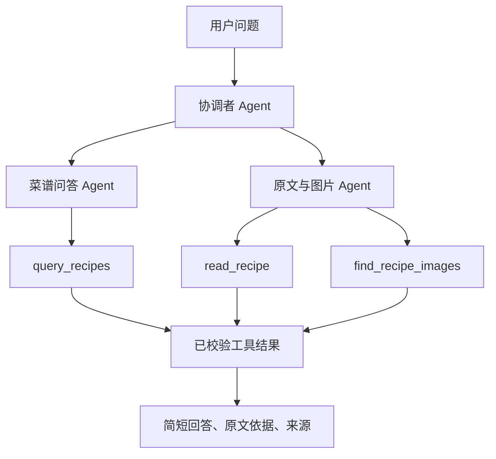

# LangChain 多 Agent 协作模式

日期：2026-10-13。本项目新增一个可选择的 `multi_agent` 模式，与原有单 Agent 和直接工具模式并列。实现使用 [LangChain 的 `create_agent` 与 Subagents 模式](https://docs.langchain.com/oss/python/langchain/multi-agent/subagents)：协调者把任务交给专职 Agent，每名专职 Agent 只能看到自己的工具。现有来源校验工具继续承担事实获取，模型的自由文字不会成为最终菜谱回答。



问答专员处理做法、配料、数量、缺料和食材推荐，继续调用已有的 Embedding → Milvus → 重排 → 来源回答链路。原文与图片专员只处理明确要求查看原文、章节或图片的任务。复合请求可以调用原文和图片两个工具。协调者和专员都使用 `Qwen/Qwen3-8B`；[ChatOpenAI 的自定义 `base_url` 接口](https://docs.langchain.com/oss/python/integrations/chat/openai)连接项目现有硅基流动配置。

原始用户问题在问答工具前恢复，避免专员丢掉“没有酱油”等库存或否定条件。原文/图片工具会把用户问题中唯一匹配的菜名恢复为知识库完整菜名，只按用户明确提到的章节词筛选；“图片”“原文”等泛词不当成章节。原文专员若误接事实问答，会要求协调者改派问答专员。底层工具沿用白名单、原文哈希及逐字依据检查；同一参数不重复执行，每次请求最多委托两次专员、执行四次底层工具。结果按工具原样展示，协调者或专员的自由总结不作为配方结论。

## 使用指定 conda 环境

```sh
conda activate py3.12.11
python -m pip install -r requirements-engineering.txt
python scripts/serve_recipe_app.py
```

页面选择“多 Agent 协作（LangChain）”；或在同一环境中运行：

```sh
python scripts/recipe_agent.py '请同时查看基础牛奶面包酵头的原文和图片' --mode multi_agent
```

原有模式仍可用旧 Python 入口。若应用不是从 `py3.12.11` 环境启动，多 Agent 模式会明确提示缺少依赖。当前 conda 环境安装了 `langchain==1.4.4`、`langchain-openai==1.7.1`；安装过程中原有 `openai` 包也随依赖从 2.11.0 更新到 3.29.0，`pip check` 通过。

## 本次验证与范围

| 真实输入 | 分派与结果 |
|---|---|
| 看基础牛奶面包酵头图片 | 原文与图片专员调用图片工具，返回 3 张原图及来源；[记录](../data/processed/agent-runs/20261012T160508109692Z-1bf0ac574ae24b298cb3d2673e015be8.json) |
| 酸辣土豆丝原文需要哪些调料 | 问答专员调用完整 RAG，回答区分原料表与计算章节并保留两处逐字依据；[记录](../data/processed/agent-runs/20261012T160031971175Z-8b6104267ade49cd89b0c7738a383b47.json) |
| 同时查看基础牛奶面包酵头原文和图片 | 原文与图片专员分别调用两个工具，原文与图片都限定在“酵头”；[记录](../data/processed/agent-runs/20261012T160344081967Z-796006fe942c4d6bb41765aba52866fa.json) |

页面接口还实际提交了一次最新 `multi_agent` 图片任务，状态为 `completed`，分派到原文与图片专员，返回图片工具结果；本次协调者和专员各做了 2 次模型决策。[执行记录](../data/processed/agent-runs/20261012T160717543228Z-9ee3ed5f7c814cc8b1a5748eb2e9c3cb.json)。项目 183 项测试通过，涵盖完整问题、菜名与章节恢复、职责边界、去重、模型自由结论不进入最终结果。

[LangChain 官方多 Agent 概览](https://docs.langchain.com/oss/python/langchain/multi-agent)指出工具很少时单 Agent 可能更合适。本项目保留单 Agent 作为对照；多 Agent 主要用于研究职责和上下文隔离。一次简单图片查询中，协调者与专员各产生 2 次模型决策，调用数高于直接工具和原有单 Agent 路径。此模式尚未证明回答准确率提高。后续工程补齐增加了按请求隔离的SQLite checkpoint及只读原文／图片联合并行工具；三场景对照仍不等于全库多轮评估。详见[工程补齐验收](engineering-implementation-and-tests.md)。后续应拿用户实际查询比较路由正确率、耗时、费用与最终来源质量，再决定是否把多 Agent 设为默认。
