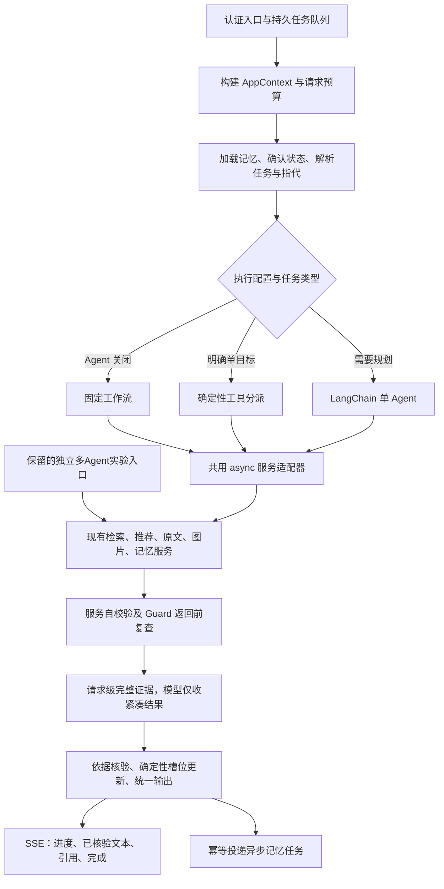

# LangChain 在线流程扩展设计

日期：2026-10-21。依据：用户提供的 `/Users/admin/Downloads/AGENT_SPEC_LangChain结构.md`。
状态：已完成在线编排迁移，并补齐跨请求HTTP/Milvus连接池与PostgreSQL检查点。迁移阶段见[实施验收](langchain-implementation-20261021.md)，当前验证和部署见[生产化补齐](langchain-production-20261021.md)。下文保留设计依据；未认证的生产化要求不计为通过。

## 1. 目标与边界

将 LangChain 从可选多 Agent 分支扩展为在线对话的统一编排层。普通菜谱问答、库存推荐、连续追问、记忆工具、来源查看、一餐规划都接入同一上下文、约束检查、运行治理和追踪机制。

底层解析、切块、Milvus/BM25/RRF、rerank、原文事实核对、库存覆盖率、记忆冲突与版本链、离线评测继续由现有纯 Python 服务负责。LangChain 工具只适配这些服务，不重写其算法。简单任务允许确定性直达工具，不强制新增规划模型调用。

## 2. 已核对的版本和 API

当前 conda `py3.12.11` 环境实际安装：

| 组件 | 版本 | 当前依赖文件状态 |
|---|---|---|
| Python | 3.12 环境 | 与任务书建议的 3.11 不同，迁移保留当前运行环境 |
| langchain | 1.4.4 | requirements-engineering.txt 已固定 |
| langgraph | 1.2.14 | 当前为传递依赖，需要补直接版本约束与完整锁文件 |
| langchain-openai | 1.7.1 | 已固定 |
| langgraph-checkpoint-sqlite | 3.1.2 | 已固定，现有同步实验路径使用 |
| pymilvus | 3.0.2 | 已固定 |
| fastapi | 0.143.0 | 环境已安装，现有网页服务并未使用 FastAPI |

已通过本地 `inspect.signature` 确认 `create_agent` 支持 `middleware`、`state_schema`、`context_schema`、`checkpointer`、`store`；`AgentMiddleware` 提供异步 `abefore_agent`、`abefore_model`、`aafter_model`、`aafter_agent`、`awrap_model_call`、`awrap_tool_call`。工具通过隐藏的 `ToolRuntime` 读取请求上下文。

官方参考（网页反映当前文档，具体签名以安装版本及 L0 测试为准）：

- [create_agent](https://reference.langchain.com/python/langchain/agents/factory/create_agent)
- [AgentMiddleware](https://reference.langchain.com/python/langchain/agents/middleware/types/AgentMiddleware)
- [内置 middleware](https://reference.langchain.com/python/langchain/agents/middleware)
- [运行时上下文](https://docs.langchain.com/oss/python/langchain/runtime)
- [流式输出](https://docs.langchain.com/oss/python/langchain/streaming/overview)

L0 已用脚本化假模型、异步工具、隐藏上下文和 checkpointer 验证闭环。真实middleware嵌套顺序、网络流式事件及断连取消也已加入专项测试。

## 3. 目标调用链

固定与直达分支共用应用层上下文、Guard、追踪与预算适配器；不将普通函数调用伪装为 Agent middleware 已执行。只有 Agent 循环实际运行 LangChain middleware。

## 4. 应用到哪些问题

| 问题 / 环节 | 目标执行方式 | 复用服务 |
|---|---|---|
| 某道菜怎么做、温度与用量 | 明确事实直达；需要跨章节推理时进入单 Agent | source_fact、query_recipes、来源复核 |
| 我有番茄鸡蛋，能做什么 | recommend_by_ingredients 工具；确定性计算覆盖率 | 现有食材归一化和库存推荐 |
| 第二个怎么做 | 确定性解析推荐槽位，再 get_recipe_detail | task_context、session、原文读取 |
| 换一个、再清淡点 | 确定性更新条件，排除已推荐项，再调用推荐工具 | 推荐状态 reducer、偏好排序 |
| 记住我不吃花生、忘掉偏好 | 记忆工具与确认流程，使用上下文身份 | ltm 管理、版本与幂等机制 |
| 我上次做过什么 | recall_history；只召回有权限的用户事件 | episodic_store、记忆检索 |
| 查看全文、图片或二者 | 原文/图片工具；两项独立只读任务可并行 | read_recipe、find_recipe_images |
| 两个人一菜一汤，20分钟 | 确定性一餐规划作为工具；不满足固定解析时交 Agent 编排 | meal_planning、推荐与依据核对 |
| 多道菜对比并查看相关原图 | 单 Agent 规划，必要时委托专员 | 现有多 Agent、共用工具 |
| 限流、超时、网络失败 | 韧性适配器及有依据的模板降级 | RuntimeStore、共享冷却、现有证据 |

Agent 决定执行顺序与选择工具，服务计算事实；最终配方结论仍受来源校验，不能直接展示未经核实的 Agent 自由改写。

## 5. 模块落点与迁移

新增 `src/llm/`、`src/agent/` 和 `src/api/`，遵循任务书的分层。`src/retrieval/` 最初仅提供纯 Python 异步服务适配入口，委托现有算法；记忆实现继续保留 `scripts/cookbuddy/ltm/`，避免先搬整仓代码。静态约束同时覆盖新适配层与现有检索/记忆核心。

| 新模块 | 迁移职责 | 当前来源 |
|---|---|---|
| llm/factory.py | 配置驱动主模型、可选备用、独立温度0结构化调用 | llm_config、cookbuddy/models |
| agent/context.py、state.py | 服务端身份、会话、请求ID、deadline；槽位和约束 | pipeline、session、MemoryRuntime |
| agent/tools.py | async 工具、参数校验、紧凑返回 | recipe_tools、ltm/tools_memory |
| agent/middleware/memory_mw.py | 记忆读写接入与提示注入 | MemoryRuntime、MemoryWorker |
| agent/middleware/guard_mw.py | 模型收到工具结果前校验；剔除违规详情 | ltm/guard、search_filters |
| agent/middleware/resilience_mw.py | 调用预算、备用模型、共享冷却与降级 | service_runtime |
| agent/middleware/trace_mw.py | 无原文的 JSON 阶段指标 | RuntimeStore 调用事件 |
| agent/build.py、degrade.py | Agent 组装与有依据降级 | recipe_agent、langchain_multi_agent |
| api/chat_routes.py | 新增 /chat SSE，兼容现有网页与任务接口 | serve_recipe_app、job_queue |

不在同一步替换现有网页、队列、存储与 Agent。先新增可独立验证的入口，再按配置逐类接入，保留旧路径回退。

## 6. 必须处理的适配点

1. **身份与状态隔离**：user_id/session_id 来自服务端验证，不暴露给模型填写。session_id 只有在全局唯一且已验证归属时才直接作为 thread_id；否则用服务端命名空间隔离。每次恢复 checkpoint 都重新验证归属并刷新硬约束。同会话请求串行化，避免覆盖槽位。
2. **工具返回与全文**：模型消息只存状态、≤200字摘要、来源位置和证据ID。get_recipe_detail 完整内容（≤4000字）留在请求级证据区交给校验/展示；ToolMessage 与 checkpoint 仍存紧凑结果。任务书第2/6/15节关于详情长文本的边界不一致，采用更严格的全文不入 checkpoint 规则，并记录为明确适配。
3. **来源生成**：摘要不能代替完整配方依据。保留现有受控生成服务对完整证据的访问，工具向 Agent 返回已经核验的结论与引用；Agent 自由文本在核验通过前不成为用户可见配方结论。
4. **异步与取消**：优先 async HTTP/存储接口；旧阻塞服务暂经有界适配器调用，保留子进程硬超时。asyncio.wait_for 包裹线程并不能停止线程，不能据此宣称断连已取消底层工作。SSE 断连取消任务并终止关联可取消调用；不可取消的兼容调用必须有资源与时限上界。
5. **治理只有一个执行主体**：middleware 调用既有 RuntimeStore 的跨进程限流、Retry-After 和熔断，不再叠加第二套 SDK 自动重试。共享冷却不能因备用模型使用同一供应商而绕过。备用模型未配置时明确走模板降级，不擅自指定新供应商。
6. **预算分阶段校准**：任务书30秒请求/2秒重排为新入口实验初值，不直接覆盖现有180秒任务预算、12秒重排阶段预算。工具8秒预算必须覆盖实际内部阶段，不能简单把当前40秒生成链塞入8秒工具后称为完成。先测异步服务拆分与排队，再决定生产默认值；统一采用最早到期 deadline。
7. **安全流式**：tool事件只含工具名/状态；生成中的未经核验配方 token 不直接外发。先输出进度，核验后分段输出文本，最后 citations/done。需要更早 token 时按已完成核验的块放行，不能为首 token 延迟跳过依据与硬约束检查。
8. **记忆与摘要单一写入**：画像版本与 session 槽位继续以现有存储为权威；middleware 负责调用，不复制另一套决策。只保留一种摘要执行路径，避免 LangChain 摘要和现有摘要重复运行。普通提取异步投递；显式记住/忘记可按任务书工具规定执行短事务与确认，幂等防重复。
9. **日志与会话数据分离**：运行日志只保留允许的指标；用户消息、画像与全文证据属于受权限控制的业务存储，不输出到 trace。默认关闭外部追踪；LangSmith 不能隐式收集原文。
10. **实验模式**：现有M0–M6七档保留；六个命名模式的显式映射见实施验收，历史M4不被隐藏合并。线上始终保留当前请求中的硬限制和必要确认；不安全消融只允许隔离评测。在线开关通过不可变请求配置传入，原受控矩阵也改为读取配置文件。

## 7. Middleware 顺序与状态

已采用 Trace → Resilience → Memory → ContextSummary → Guard。before hook顺序、after反序、wrap进入与退出顺序已经实测并用T-L20固定。

AppContext 至少包含 user_id、session_id；请求运行依赖另包含 request_id、message_id、deadline 与服务引用。身份不可由模型覆盖，连接对象和密钥不进入 checkpoint。AgentState 包含 slots、hard_constraints、pending_confirmation、degraded、filtered_out_total 与有界 messages。硬约束每轮从权威服务重载，不信任旧 checkpoint。

当前默认使用PostgreSQL checkpoint、事务级RLS身份和数据库会话锁，支持多个进程/节点共享检查点；连接池在应用生命周期内关闭。SQLite和文件锁仅作显式开发配置，测试仍可使用内存实现。检查点不包含连接对象、凭据或完整工具原文。

## 8. 实施与验收顺序

| 阶段 | 交付与验收 | 切换在线流量 |
|---|---|---|
| L0 | API/版本记录、可编排假模型+async假工具+checkpointer 示例；实际 hook 顺序与异步流测试 | 否 |
| L1 | 模型工厂、async服务边界、紧凑工具、Agent/fixed 分支；T-L1~3 | 否 |
| L2 | 身份隔离、工具前后双重约束、证据区、降级；T-L7~10、13 | 小范围显式新入口 |
| L3 | 共享治理接入、预算、备用模型、取消与重排回退；T-L11~16 | 故障注入通过后 |
| L4 | 记忆与确定性槽位、单摘要路径；T-L4~6、17 | 逐类接入问答/推荐/追问 |
| L5 | SSE、配置与实验覆盖、Trace；T-L21~25 | 浏览器验证后逐步切换 |
| L6 | 静态依赖边界、日志检查、顺序测试；T-L18~20与全套回归 | 满足迁移门槛后设默认 |

每阶段按任务书跑现有回归；新增用例使用假模型，不依赖真实供应商。真实 Milvus/PG 采用已有集成测试环境。检索对照固定同一活动索引、同一开发评测输入和配置，新目录保存结果；Recall/MRR 下降超过1个百分点需诊断与记录。来源封存v3和原历史验收文件保持不变，不把本轮开发对照替换为新的盲测结论。

独立记录路由命中、工具实际执行、硬约束违规、checkpoint 大小、首段已核验输出延迟、全程延迟、降级率和计费信息；不能用“用了 LangChain”替代收益验收。T-L17 假队列5毫秒检查与实际投递延迟分别报告。

## 9. 当前交付限制

本轮已实现统一编排、middleware、async工具适配、SSE及现有页面兼容入口，并完成全量回归与真实供应商联调。明确任务仍允许确定性直达，不承诺所有问题走多Agent。旧同步服务使用可取消进程隔离，应用持有网络服务复用跨请求连接，检查点改用PostgreSQL。长期负载和全系统多机部署尚未验收，不能据此宣称完整PRD100%通过。
