# cookbuddy 记忆系统

2026-10-27：难度上限、用餐人数、时间预算与现有食材只作为当前会话条件，不再写入长期画像；即使模型输出global或用户说“记住”，也按session处理。写入边界拦截这类新增记录，读取画像与偏好查询忽略旧版本遗留项。口味、忌口等其他长期偏好沿用原规则；历史对话与本会话条件仍可正常恢复。

依据用户提供的 `AGENT_SPEC_记忆系统.md` 实施。2026-10-18 已完成 P1–P6 的代码接入、数据库迁移和本地功能验收；**已切换硅基流动 `deepseek-ai/DeepSeek-V4.1-Flash` 并复用现有 Embedding 密钥；真实在线提取、摘要、改写及 PG/Milvus 冒烟验收通过，原 HTTP 402 阻塞解除**。详见 [本轮验收与改动清单](memory-implementation-20261018.md)。

## 架构与数据流

```mermaid
flowchart LR
    U[认证用户消息] --> S[短期窗口 / 摘要 / 槽位]
    S --> P[读取版本化画像]
    P --> G[工具层硬约束过滤]
    E[相关用户事件] --> S
    G --> A[现有 Agent / RAG / 原文工具]
    A --> C[原文复核与硬约束二次检查]
    C --> R[回答]
    R --> Q[后台队列：只提交用户消息]
    Q --> X[规则 + LLM 结构化提取]
    X --> D[冲突决策与确认]
    D --> DB[PostgreSQL 画像 / 审计 / 事件]
    DB --> O[向量投影队列]
    O --> M[Milvus user_memory]
    M --> E
```



- 主编排沿用 `scripts/cookbuddy/pipeline.py`；多 Agent 分支继续使用已有 LangChain/LangGraph，工具执行时显式携带约束上下文。
- 实现在 `scripts/cookbuddy/ltm/`，短期上下文在 `scripts/cookbuddy/session.py`。沿用现有标准库 HTTP 服务，无需迁移至 FastAPI 或创建第二套 `src/` 入口。
- PostgreSQL 保存结构化画像、版本链、审计、待确认、事件及后台任务，使用认证用户 ID、RLS 和事务锁隔离。
- Milvus `user_memory_<embedding空间指纹>` 保存事件向量，HNSW/COSINE，与菜谱使用同一 Embedding 配置；关系库是权威数据源。
- 现有菜谱集合缺少食材数组，采用完整原文计算来源允许列表，将 `source in [...]` 拼入每个 Milvus 检索通道；本地推荐也先过滤，返回前再检查。数量不足时遍历允许候选补齐；结果被二次检查否决时最多重新检索一次，不放宽硬约束。

## 行为约定

1. 窗口默认六轮，超预算滚动摘要。持久化完整槽位，模型只接收有界投影；只保存菜名、来源和结果摘要，不将工具长文放进模型历史。使用 PostgreSQL 检查点适配独立问答子进程，无需 Redis。默认 24 小时有效，过期任务状态也不再使用。
2. 顺序指代绑定实际展示列表；“换一个”排除上轮推荐；临时口味覆盖长期软偏好。对从画像继承的口味保存来源标记，画像改变后会刷新，不会永久固化成旧任务条件。
3. 现有食材始终属于当前会话的短期记忆，存入 `ingredients_on_hand`；新对话不继承库存，即使说“记住”也不写长期画像。稳定口味与忌口属于长期记忆，“我不吃”是长期硬限制；“今天/这顿”的口味和“不要放”只影响当前会话，“最近”的临时口味默认 30 天。历史库存保留原始记录供导出核对，但不再参与长期画像、记忆展示或推荐。
4. 新硬限制参与当轮过滤。队列未消费期间，已声明的硬限制仍参与检查；解除、放宽须确认。无关回复不视为同意，待确认默认三轮或 24 小时过期。会话临时硬限制同样需要明确确认才能撤销。
5. 用户消息是提取器唯一输入，最近最多两条用户消息仅用于理解省略；助手、工具、菜谱内容不进入写入管线。规则先处理明确语句，LLM 补充结构化候选；非法维度、值域或无用户证据的候选拒绝。
6. 用户明确声明稳定口味、忌口时同步更新长期画像，无需额外说“记住”；隐式提取仍在回答之后由已有持久队列执行，失败不撤回回答。显式记忆工具、管理接口与确认操作复用同一决策/事务逻辑；库存候选由代码强制限制为会话范围。
7. 更新生成新 ID 与版本，旧记录置 `superseded`；撤销软删除并保留审计。辣度更新替换旧值；清淡与重口相互替换，少油等兼容偏好保留。“不再喜欢某口味”记录为负向口味偏好，不误记为食材忌口。重复来源幂等，旧消息补写不覆盖新偏好。隐式偏好先 pending，默认三条证据、两个会话后才升级；与显式偏好冲突时询问。
8. 事件只来自用户明确反馈、做过、收藏或拒绝。相似事件去重；相反反馈不会因向量接近而合并。召回按相似度、时间、重要度计分并设阈值，最多三条。
9. 软偏好与近期重复影响候选排序，保留探索位。没有难度等来源字段时不虚构数值。记忆作为资料注入，不能替代菜谱证据或指挥工具。
10. 关闭记忆后，问答不读取或写入画像、事件、短期检查点；聊天记录功能独立保留。清空会物理删除记忆内容及短期状态、作废旧任务，并删除新旧向量投影；保留空的开关/epoch 标记防止旧任务恢复。历史聊天不会因此被删除。

## 工具与管理接口

工具 `get_user_profile`、`remember_preference`、`forget_preference`、`recall_history` 的身份来自编排上下文。模型提供的 `user_id/session_id` 不被采纳。`tools_memory.py` 的定义仅在认证记忆上下文内提供给单 Agent。

以下接口支持 `/memory` 和 `/api/memory` 两种前缀，使用现有签名 HttpOnly Cookie 识别用户，拒绝请求体或查询参数指定身份：

| 方法 | 路径 | 行为 |
|---|---|---|
| GET | `/memory` | 当前 active/pending 画像及事件摘要，过敏值脱敏 |
| PATCH | `/memory/{id}` | 版本化修改；支持 `version` 并发检查和 `restore_version` 回溯 |
| DELETE | `/memory/{id}` | 软删除；硬限制需 `?confirm=true`，否则 409 并创建确认 |
| DELETE | `/memory` | 清空并返回数据库、向量删除回执 |
| GET | `/memory/export` | 导出当前用户记忆 JSON |
| PUT | `/memory/settings` | `{"enabled":false}` 关闭，或 true 开启 |
| POST | `/api/conversation/end` | `{"id":"会话ID"}`，幂等提交该会话已回答的用户消息 |

前端“新对话”会通知结束旧会话；闲置 30 分钟也会触发幂等整理。普通聊天页面不增加画像管理面板，待确认时仅显示一句确认问题。

## 安装与运行

在项目的 `py3.12.11` 环境下：

```sh
python scripts/setup_memory.py
python scripts/serve_recipe_app.py --port 8080
```

本轮迁移为 `006_versioned_memory.sql`、`007_memory_queue_epoch.sql`、`008_memory_purge_jobs.sql`、`009_event_compression.sql`，本地已应用。初始化脚本可重复执行，并只从能核对到用户原消息的旧画像迁移；菜谱知识、助手任务总结不转换为用户记忆。未解析的旧值不猜测提升。

`config/memory.yaml` 使用 JSON 兼容的 YAML 子集；当前通过标准库读取，不额外引入 YAML 解析依赖。配置包含窗口、摘要、TTL、证据门槛、衰减、临时期限、召回权重、探索位、确认期限及实验开关。

维护随现有 `MemoryWorker` 运行：每五分钟检查过期、衰减、容量和待确认，处理投影重试；每周去重和压缩，每日扫描孤儿向量用户。压缩保留原事件，降低其重要度并登记已压缩标记，重复运行不会反复折损同一批事件。

向量服务不可用时，清空回执为 `vector_deletion=pending_retry`，由持久删除任务重试；不会声称向量已删除。读取仍以数据库状态与版本为准。

## 验证与实验

```sh
COOKBUDDY_INTEGRATION_TESTS=1 python -m unittest discover -s tests
node --test tests/test_answer_rendering.cjs
python eval/memory/evaluate.py --all
python eval/memory/retrieval_regression.py
python scripts/accept_memory_v2.py
```

- 自动化用例覆盖 T-S、T-H、T-R、T-E、T-A、T-M 的核心行为、错误分支及真实 PostgreSQL/Milvus/HTTP 隔离。
- `eval/memory/memory_dialogs_v1.jsonl` 是 15 个自建诊断对话，评测输出在 `eval/memory/reports/{run_id}/`，包含配置、代码/数据哈希、commit（无提交时为 null）、逐题决策及指标。
- M0–M6 及 scope/confirmation/filter 消融在隔离 SQLite 中运行。M3 的朴素画像、M4 的无确认行为属于评测基线；线上仍保留强制确认等安全规则，不为实验对真实用户关闭保护。线上 M0–M2 停止长期读写，M5 停止事件召回和加权，M6 启用全部模块。
- 本地 P95 和 token 上界不是生产网络延迟或供应商计费。提取 P/R 来自该小型规则诊断集；不代表通用自然语言能力。
- 原任务书的 `eval_dataset_v1` 未在仓库找到。本轮采用已有 `prd-dev-v1` 的八道有证据题，比较重建的原检索流程与无记忆的新流程；不是历史部署快照或独立盲测。

切换后的真实在线提取、两次摘要、指代改写、Embedding/Milvus 事件召回、硬过滤和清空均已验证。报告记录供应商返回的 1070 个 LLM token，仅覆盖本次四次记忆模型调用，不包含 Embedding/Rerank 或其他请求费用；不是性能 SLA。详见本轮验收清单中的硅基流动报告。

Milvus 字段实现参考：[Array 字段文档](https://milvus.io/docs/v2.5.x/array_data_type.md)、[创建集合与索引 API](https://milvus.io/api-reference/restful/v3.0.x/v2/Collection%20%28v2%29/Create.md)，并用仓库已安装的 pymilvus 在本地创建、写入、查询验证。
