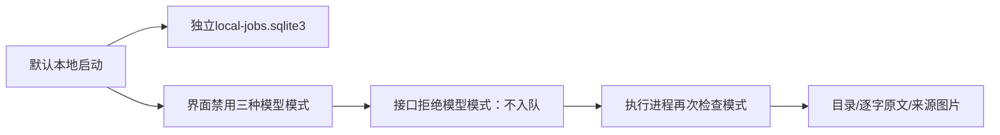

# 项目运行、检查与演示交付

日期：2026-10-13。本批增加统一运行入口，区分本地工具与完整问答启动条件。环境沿用 conda `py3.12.11`，不会自动更换解释器、安装依赖、填写密钥、重建知识库或结束端口上的其他服务。

后续阶段的全库来源检查、同机独立venv部署复现和真实问答并发见[阶段验收与进度](stage-acceptance-v1.md)。下文274项测试与首次运行边界是本运行交付批的历史记录。

## 三个入口

在项目目录执行：

```sh
conda activate py3.12.11

# 只检查本地文件与配置，不请求远程模型。
python scripts/project.py check

# 额外只读检查Milvus、Docker及本项目应用。
python scripts/project.py check --live

# 默认本地模式：目录、原文和图片。已有8080服务时可用8081。
python scripts/project.py start --port 8081

# 另一个终端执行本地演示，端口与启动命令一致。
python scripts/project.py demo --port 8081
```

启动命令在前台运行，按Ctrl+C关闭。相同端口上的本项目同模式服务会复用；模式不同、口令不匹配或端口属于其他服务时拒绝接管，需选择其他端口。不会自动重启或结束已有服务。

需要真实RAG、单Agent或LangChain多Agent时：

```sh
conda activate py3.12.11
python -m pip install -r requirements-engineering.txt
python scripts/project.py check --live
python scripts/project.py start --full
```

完整启动需本地检查、工程依赖、向量空间配置和实际Milvus集合状态通过。模型密钥权限、余额、网络响应与回答质量仍未验证；“具备启动条件”不等于“在线模型健康”。完整模式运行时会使用现有模型API，产生调用费用。

## 第一次运行缺东西怎么办

| 检查结果 | 含义与处理 |
|---|---|
| Python环境阻塞 | 当前解释器不符合指定环境，先激活`py3.12.11`；入口不会自行切换或安装 |
| 应用／图片索引缺失 | 恢复项目文件和对应产物；索引JSON及本地图片路径也会检查 |
| 知识库缺失或变更 | 缺活动配置、分块、元信息、入库核对记录，或原文与文本块不一致；先恢复或按版本准备流程重新核对 |
| 本地tokenizer缺失 | 当前长章节版本需要`tiktoken`进行原文重分块检查，缺失时本地启动也阻塞 |
| 模型配置待检查 | 缺`EMBEDDING_API_KEY`或地址、模型、维度与已入库向量不一致；本地模式仍可启动 |
| Milvus待检查 | 本机服务不可访问、活动集合未加载，或维度／数量不匹配；在Docker Desktop核对已有容器与集合 |
| 应用待检查 | 应用未启动、口令不匹配或该端口不是本项目；先启动或选择其他端口 |

缺配置时可手动将`.env.example`复制为`.env`并在本地填写。已存在的`.env`不要覆盖，密钥不要写到聊天、示例文件或诊断报告。服务治理参数按示例说明通过环境变量设置。

当前检查器只输出状态、行动建议、知识库数量和集合名，不输出密钥、访问口令或模型配置值。`check --json`可供脚本读取；退出码只表示本地启动是否被阻塞，完整模式条件看`full_prerequisites`。`remote_model_access`固定为`not_checked`，不会用读取配置代替真实模型验证。

这不是从一台全新电脑开始的完整部署验收。数据下载、Conda环境创建、依赖安装、首次tokenizer缓存准备和Milvus安装仍需按已有流程完成；入口负责给出缺项与阻塞原因，不悄悄补齐它们。

## 检查的证据与边界

[project_doctor.py](../scripts/project_doctor.py)在读库前仅依赖标准库，因此缺数据／缺SDK时也能返回可执行的提示。

- 检查Python 3.12.11及环境名、应用与图片索引文件。
- 核对活动版本分块数量、ID唯一性、文本文件SHA256、版本的入库核对标记。
- 对每个文本块核对来源路径、原文件、合法行号范围与唯一的逐字正文位置；本次实际检查2074块与372份原文。
- 检查本地图片文件与受限路径，以及长章节所需的本地tokenizer依赖。
- 按工程依赖清单检查安装版本；核对在线RAG实际使用的配置字段与向量空间元信息。仅旧`GITEE_AI_API_KEY`字段不算当前RAG已配置。
- `--live`仅请求本机Milvus的`collections/describe`和`collections/get_stats`，核对已加载、1024维与2074条；不写入、不加载／删除集合、不获取其他集合数据。
- 只读查看`milvus-standalone`和`recipe-attu`容器状态。Docker状态不代替Milvus实际集合检查。

这些检查证明启动产物和部分服务条件，不证明食材事实、模型输出准确率、生产容量或高可用。当前版本仍使用已有独立来源与回答核验。

## 为什么本地模式要三层限制



仅在界面隐藏按钮不够，调用接口或已有队列任务仍可能执行。现在：

1. 页面标明“本地模式，模型请求已禁用”，默认选择原文，禁用Agent、多Agent与RAG，隐藏需模型的示例。
2. API在入队前拒绝三种模型模式，返回400，不占用任务槽。
3. 执行进程再次检查，禁止通过队列绕过模式限制。

本地启动使用独立任务库，不认领完整模式的任务。已有队列、并发预算、取消和原文校验仍沿用；本地模式禁止远程**模型请求**，不是声称Python包安装、首次tokenizer资源或浏览器不需要任何网络。

端口确认使用公开的`/api/identity`，仅返回项目路径的匿名指纹与运行模式。确认匹配后才携访问口令请求受保护接口，避免误发给其他本机服务。指纹用于避免误复用，不是密码认证；目录、来源、任务和指标仍使用已有访问控制。

## 五分钟演示顺序

1. 运行`check --live`，说明本地可用与模型配置未验证的区别。
2. 在本地模式展开目录，搜索“陈皮排骨汤”，展示两个来源不能合并。
3. 打开两份原文，指明真实路径与行号；再查看文件夹来源对应的一张图片。
4. 运行`demo`，查看全量目录分页、同名选择、逐字引用与图片检查记录。
5. 如要演示模型RAG，另以完整模式启动；保留API失败或降级记录，不把本地工具成功说成模型成功。

`demo`只执行本地原文／图片流程。每次生成`data/processed/run-delivery/<时间戳与随机标记>/local-flows.json`，不覆盖先前验收记录。应用不可用时给出启动提示并退出1。

## 实际验收

本批**274项项目测试通过**，其中新增16项覆盖空项目、缺密钥、本地源文件变更、向量空间配置冲突、本地tokenizer缺失、服务故障、敏感值不进入诊断、端口冲突不接管、同模式复用、独立任务库、API和worker双重拒绝、匿名身份不泄露目录以及未知服务不接收口令。

真实验证：

- 检查当前372份来源与2074个块；当前配置、工程依赖、Milvus集合和容器满足完整模式启动前提，`remote_model_access`仍为`not_checked`。
- 通过`project.py start --port 8081`启动本地模式；再次启动复用已有服务。完整模式8080也可通过入口确认并复用。
- 两次本地`demo`完成，所有引用逐字核对，图片来源匹配，远程模型调用数为0，记录分开保存。
- 真实接口拒绝Agent、多Agent、RAG三种模式，任务计数未变；不存在的应用端口演示返回1和明确提示。
- 浏览器中三种模型选项禁用，库存问答示例隐藏，蒸水蛋操作原文查询完成；未观察到控制台错误或警告。

证据见[交付验收汇总](../data/processed/run-delivery/acceptance.json)、[运行检查](../data/processed/run-delivery/doctor-live.json)、[本地模式API](../data/processed/run-delivery/local-mode-api.json)、[测试记录](../data/processed/run-delivery/unit-tests.json)和[浏览器截图](../data/processed/run-delivery/local-mode.jpg)。临时8081验收服务在完成后关闭，现有8080完整模式保留；后续使用可自行执行启动命令。

本批到此收口，下一阶段不继续扩充诊断器。本入口不替代部署编排、依赖锁定、模型服务监测或生产运维。
