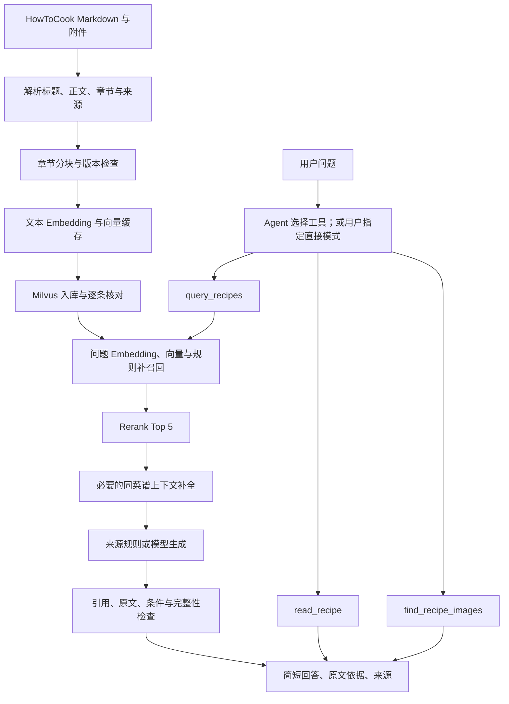
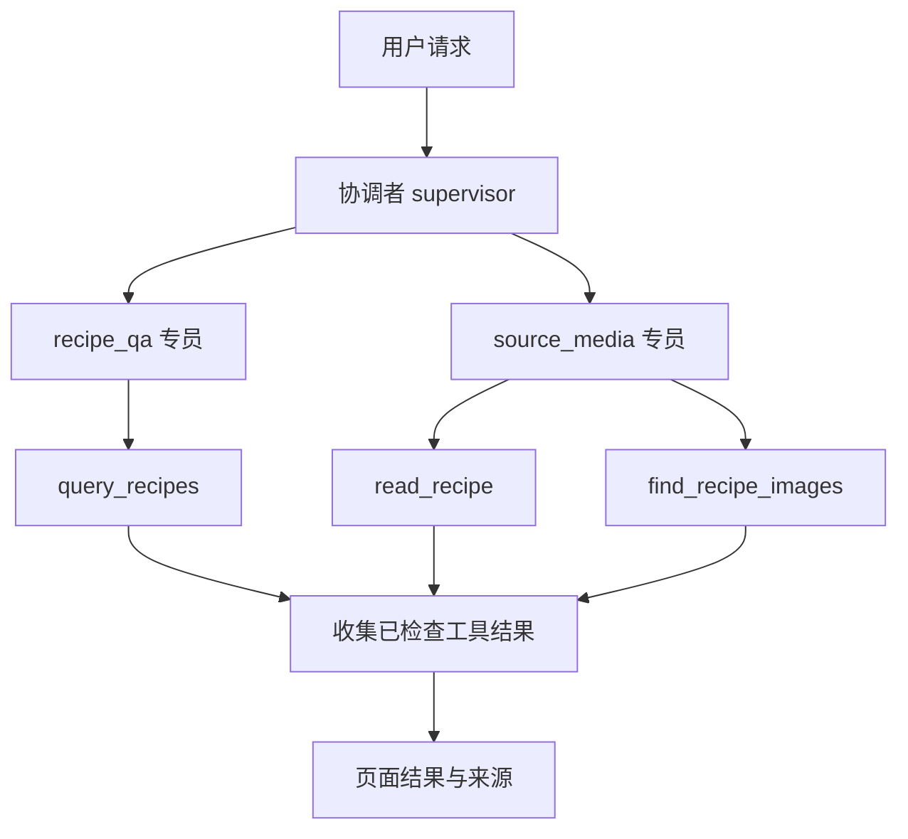

# 菜谱 RAG 知识库与 Agent：设计逻辑及面试追问

更新时间：2026-10-13。本文根据当前代码和验收记录整理。后续工程补齐已经落地，详见[实现与测试对应表](engineering-implementation-and-tests.md)。本文区分启用功能、可选功能与仍未验证的生产能力；六题检索对照及本机负载测试不等于全库准确率或生产容量。

**当前进度：** 用户要求的文档解析、向量检索、重排序、Agent工具接入、LangChain多Agent、并发与超时治理均有实现和测试；全项目278项测试已通过。372/372来源工具检查、10分类检索重排与三次在线问答的最新证据见[阶段验收](stage-acceptance-v1.md)。本文后面228／246等数字对应历史批次。逐项完成度与演示入口见[项目完成度核对](project-completeness-review.md)。学习MVP与面试材料已具备，生产上线尚未验收。

## 1. 面试开场：一分钟介绍项目

> 我做了一个基于 HowToCook 的菜谱知识库，用于查询做法、核对已有食材、查看原文和步骤图片。离线按 Markdown 章节解析菜谱，保留菜名、章节、路径和行号，生成向量后写入 Milvus。在线通过问题向量检索、菜名和食材补召回，再用 Qwen Reranker 排序，结合必要的同菜谱章节生成有依据的回答。外层 Agent 根据用户意图选择问答、原文或图片工具，底层 RAG 保持可检查的固定流程。我还实现了 LangChain 协调者与专员的多 Agent 模式，但它目前是实验选项。项目的重点是防止混菜谱、漏配料和把可选项当必需项，并提供可以回到原文核对的答案。

这段介绍后，应主动说明：项目是本地学习 MVP，已经实现完整链路和有限场景验证，尚未验证生产高并发、全库准确率或多 Agent 相比单 Agent 的质量增益。

### 当前实现速查

| 项目 | 当前实际实现 |
|---|---|
| 数据 | HowToCook `dishes` 中 372 篇菜谱，2074 个章节／子块（旧版为2058块）；排除贡献模板、测试重复副本和工程文件 |
| 分块 | Markdown 二至六级标题；保留简介和章节层级；长章节使用768个 cl100k_base token 的正文长度代理再切子块；默认无重叠 |
| 元信息 | `chunk_id`、菜名、章节、原文路径、起止行号、正文及带元信息的 `text` |
| Embedding | 全量库元数据为 `Qwen/Qwen3-VL-Embedding-8B`，1024 维，硅基流动 API；目前仅输入文本 |
| 向量库 | Milvus standalone，当前集合 `recipe_bounded_v3`，`COSINE / FLAT`；保留旧版和 HNSW 对照集合，检索请求使用 Strong consistency |
| 召回 | 向量 Top 20、中文 BM25、明确菜名与有限食材补召回；RRF 融合并按 `chunk_id` 去重 |
| 重排 | `Qwen/Qwen3-Reranker-8B`；对合并候选重排，保留 Top 5 |
| 上下文 | Top 5 是初选；特定场景还补充同一菜谱其他章节，最终不一定只有 5 块 |
| 回答 | `Qwen/Qwen3-8B`，以及有限来源规则、原文摘录、数量公式计算分支 |
| 工具 | `query_recipes`、`read_recipe`、`find_recipe_images`，后端白名单与参数检查 |
| Agent | 原有单 Agent；新增 LangChain `create_agent` 协调者与两个专员 |
| 运行环境 | 多 Agent 使用 conda `py3.12.11`；依赖锁定在 `requirements-langchain.txt` |
| 服务 | 本机网页、SQLite持久任务队列、状态轮询；默认全局2个执行槽、最多8个未完成任务；超额429；支持幂等、取消和180秒总预算 |

**模型名称要说准确。** 早期讨论过文本 Embedding 模型，但当前全量库记录的是 VL 版本。使用多模态模型的文本接口，不等于已经把图片向量化，也不能直接引用文本版本的模型报告作为本项目的实测效果。

## 2. 总体流程：知识入库与在线使用

**为什么 Agent 在图上位于检索前面？** 文档解析、检索、重排、工具接入是建设顺序；用户实际使用时，Agent 先选择工具。只有选择问答工具才进入检索链路，查看全文或图片可以直接走本地工具，避免不必要的模型调用。

**RAG 与 Agent 的关系：** RAG 负责获取和利用外部知识；Agent 负责决定调用什么能力。可以没有 Agent 而直接运行 RAG，也可以调用无需向量检索的工具。两者不互相替代。

## 3. 文档解析：为什么选择这份数据，如何保留证据

### 3.1 为什么用 HowToCook

它的 Markdown 菜谱通常包含原料、计算、操作等标题，适合用可解释的结构解析开始；数据可以本地保存，能逐行回看，方便学习和构建可复现案例。问题也贴近真实约束：同一种菜有多个版本，食材有可选项，步骤和原料表可能不一致。

不能把“有结构”说成“内容完全规范”。已经遇到原料表漏项、步骤另用调料、时间表述不同等情况。知识库应保留这些差异，而不是在清洗时自行修正作者配方。来源许可沿用仓库文件，更新时需要保存来源版本。

### 3.2 当前如何解析

读取 UTF-8 Markdown；一级标题作为菜名，二至六级标题建立章节层级。解析器识别反引号和波浪线代码围栏，避免把围栏中的 `##` 错当章节；不保留只有标题而无正文的空块。图片 Markdown 引用保留在正文，附件另建索引。

每块保留原文起止行号，生成回答前还检查正文是否能唯一对应回原文件。这样引用是系统从原文定位的，不能让模型自由编造引用路径。

**追问：为什么不用一个通用 Markdown parser？**

当前数据边界有限，小解析器容易观察、修改和核对。但正式菜谱解析器仍围绕当前格式；新增通用候选解析器覆盖 Setext 标题、代码围栏、PDF 页码及 DOCX 段落／表格节点。复杂 HTML、版面表格和跨行合并仍需成熟解析器与更多格式样本验证。

### 3.3 图片、PDF 和 OCR 怎么说

当前保留 354 个本地图片文件及来源关联，远程图片链接单独标记为未下载、未核验。OCR 和视觉描述是隔离试验；少量核对过的图中文字仅用于找图，不作为配料数量事实。不能从成品照片推断内部熟度、精确温度或配比。

新增 MD/PDF/DOCX 候选解析入口；PDF区分文本提取与扫描件OCR，DOCX保留段落／表格节点定位，OCR保留识别区域及置信信息。文本PDF与扫描件已做真实本地样本验证，DOCX段落与表格有测试。非MD来源尚未进入正式配方问答，音视频尚未接入；复杂版面不宣称完整保真。

## 4. 文本分块：为什么按副标题切

### 面试回答

> 菜谱的原料、计算、操作是自然的语义边界。按章节切能保留一个步骤段或原料表的完整上下文，避免固定字符切分把数量、条件或列表截断。我还给每块附上菜名和章节层级，让“180℃烤 30 分钟”这类孤立语句能对应到具体菜谱与阶段。代价是章节长短不一、跨章节问题需要补上下文，所以我通过同菜谱补全弥补，而不是认为切完就没有问题。

### 4.1 为什么不把整篇菜谱作为一个向量

整篇包含原料、多个制作阶段和其他建议，语义主题会混合，影响某个具体步骤的定位；也会让 Rerank 和生成阶段接收更多无关内容。但短菜谱整篇检索可能很有效，应通过评测比较，而不是一律否定。

### 4.2 为什么不固定每 500 字切一次

固定长度简单，却可能把“盐 2g”和后续条件分开，或让两个版本的步骤落入同一块。500 字也不等于 500 token。当前基于标题的切法是数据结构驱动，不是证明了某个长度最优。

### 4.3 为什么没有 overlap

当前以章节或长章节子块作为单元，默认没有滑动窗口重叠。任意重叠会重复列表和步骤，造成重复召回、引用歧义及上下文浪费。跨章节依赖通过元信息和同菜谱补全处理。

**已实现：** 新版对15个过长章节按完整行边界再切子块，保留父章节、子块序号、稳定内容ID和原文行号；默认零重叠，候选解析器也支持配置行重叠。768为cl100k_base正文token长度代理，并非Qwen精确token计数；单行超长明确拒绝，复杂多行步骤仍需更细边界识别。

### 4.4 为什么向量文本里也放路径

当前 `text` 是“菜名＋章节＋原文路径＋正文”，有利于检查和追溯；但路径字符可能引入语义噪声。候选解析器与版本准备器已提供去掉路径的输入模式，路径仍作为结构化元信息；正式版本为复用已验证向量继续保留路径。尚未做全库去路径质量对照，不能声称该选项提升检索。

### 4.5 文档更新会怎样

当前缓存绑定源分块哈希、模型、维度和服务地址；源文变化时停止旧版本导入，避免混合向量。旧版`chunk_id`含路径和章节序号；新版使用来源、章节、子块序号和正文的内容哈希，未变块可保持ID。新增章节、改标题或改路径仍可能改变ID，不能把它当作永久业务身份。

**已实现：** 来源清单和内容哈希、增删改计划、稳定子块ID、匹配文本／模型／维度的向量复用，以及独立集合逐条验收、隔离别名切换与回滚、活动配置原子切换。首次新版新增31个向量，最终修订版复用2074个已生成向量。模型变化仍需重建整个对应向量空间。

## 5. Embedding 与 Milvus：检索原理及选择理由

### 5.1 Embedding 做什么

它把文本映射成固定维度向量，使含义相关的表达能在向量空间接近。文档向量离线算，问题向量在线算；模型、维度和输入约定必须匹配。**相同维度不代表相同向量空间**，更换模型后不能复用旧库向量。

本项目把模型、1024 维和源哈希写入元数据，并检查返回向量长度、有限数值和非零向量。1024 维是当前配置与可用接口的选择，没有做维度消融，不能说它是最优维度。当前查询输入是原始中文问题，未加入额外任务指令；后续可比较模型推荐输入格式，但必须保持离线和在线约定一致。

### 5.2 为什么用 Milvus

选择它是为了学习持久化向量集合、元信息过滤、索引与服务管理，以及通过 Attu 观察数据。当前只有两千余块，简单本地向量库也能满足规模需求；不能说因为数据巨大才选 Milvus。未来如扩展索引、容量和部署，Milvus 提供相应路径，但 standalone 不是集群高可用。

### 5.3 为什么是 COSINE 和 FLAT

余弦相似度比较向量方向：

\[
\operatorname{cos}(q,d)=\frac{q\cdot d}{\lVert q\rVert\lVert d\rVert}
\]

FLAT 对待搜索向量集合进行精确比较。当前2074块的规模较小，使用 FLAT 能减少近似索引带来的诊断变量：如果没找对，更应检查语义表示、问题、候选数量和数据，而不是先调 ANN 参数。精确近邻也不等于正确答案，因为语义相似度不是业务事实判断。参见 [Milvus FLAT 文档](https://milvus.io/docs/flat.md)。

**追问：为什么不用 HNSW？**

数据量或延迟压力增长后可以对照 FLAT 评测 HNSW。`M` 影响图连接规模，`efConstruction` 影响构图搜索，查询 `ef` 影响候选搜索范围；通常更大的搜索范围换取更高召回但增加开销。应比较 Recall、P95 延迟、内存和构建时间，不能只背一套参数。正式版本仍用FLAT；已在独立HNSW集合对6个真实问题、3组ef设置做对照，未据此宣称全库性能更优。参见 [Milvus HNSW 文档](https://milvus.io/docs/hnsw.md)。

原始 float32 向量体积约为 `2074 × 1024 × 4 ≈ 8.1 MiB`；这不包含文本、索引、运行时和 Milvus 服务内存，不能据此估算整个部署只需要 8 MiB。

### 5.4 Strong consistency 的代价

当前用于导入核对与查询，便于观察已写入数据；但一致性是可见性问题，不提高语义准确率。读多写少的扩展场景可评估适当一致性级别，权衡新数据可见时效与等待成本，不能直接断言换级别会提升某个固定倍数。

## 6. 召回不准怎么办：先定位，再优化

### 当前召回包含向量、BM25与规则通道

1. 全库向量检索取 Top 20。
2. 问题包含明确菜名时，补回该菜谱全部章节。
3. 对有限的“我有……”食材列举规则，匹配必备原料表，最多补 3 个候选来源的章节。
4. BM25按中文字符／双字与英文词提供词法候选；以RRF融合各通道排名，按 `chunk_id` 去重并保留 `retrieval_channels`，再交给 Rerank。

合并候选可能超过20。BM25使用本地倒排表；菜名补回是元信息过滤辅助检索，食材补回仍是受限规则，不能把它们说成完整约束求解器。中文BM25已经接入；食材规则仍无法完整处理数量、别名、忌口和复杂否定。

### 面试回答

> 我先检查正确证据到底有没有入库、有没有进入候选、有没有在重排后保留、有没有被生成正确使用。正确证据根本没召回时，增加 Rerank 没用；已经召回但排得低，才重点改善重排。如果问题是漏掉同菜谱其他章节，就补上下文；如果问题是“没盐也能做”的条件误判，要改条件核对，而不是简单调相似度阈值。

| 观察到的问题 | 检查位置 | 对应处理 |
|---|---|---|
| 原文有事实，但入库没有 | 解析和分块 | 检查编码、空块过滤、表格与特殊语法；修复后重新入库 |
| 入库有证据，Top 20 没有 | 召回 | 验证模型空间；加菜名约束、别名、关键词候选；评测扩大 K |
| 候选有证据，Top 5 丢了 | 重排 | 检查输入格式、截断、章节覆盖；评测 K/N 与上下文补全 |
| 正确菜谱但缺计算或操作 | 上下文 | 补相关同菜谱章节；避免混入别的菜 |
| 证据充分却漏答或错答 | 生成与校验 | 检查问题条件、完整性、数量单位、可选项与引用支持 |
| 问题本身含糊 | 请求理解 | 保留原问题；必要时澄清菜名、版本、人数或库存 |

### 已实施的融合与继续验证的方向

已加入BM25与稠密检索的RRF融合；不同分数不直接相加。别名词典应区分语义相近与可互换，例如“低筋面粉”不能因都属于面粉就替代高筋面粉。

查询改写可展开检索表达，但必须保留原始问题中的“没有”“可选”“简易版”等限制；不应让改写模型偷偷删除条件。扩大候选也会增加 Rerank 输入和延迟，因此要用评测比较，而非无限增加 K。

## 7. 为什么加 Rerank：粗召回与细排序分工

### 面试回答

> Embedding 为每篇文档预先生成向量，适合快速找到一批语义相关候选；重排模型在线联合处理问题和候选文本，更细地判断哪个章节能回答当前问题。它用更高的计算成本换取候选排序质量，所以只处理小候选集，而不是全库。它既不能找回未进入候选的证据，也不能保证最后答案正确。

当前调用硅基流动 `/rerank`，模型为 `Qwen/Qwen3-Reranker-8B`，输入保留菜名、章节及正文。检查返回 index 是否完整、唯一、覆盖候选，并检查分数是有限数值，然后取前 5。接口字段见 [硅基流动 Rerank 文档](https://docs.siliconflow.cn/docs/api/rerank-post)。

### 常见追问

**为什么 Top 20 再 Top 5？** 是当前易观察、可控制输入的起始配置，不是最优结论。应该评测候选 K、最终 N、覆盖必要章节的比例和耗时。当前还补同菜谱章节，所以实际生成上下文并不严格限制为 5 块。

**为什么不能把向量分数与重排分数比较？** 它们来自不同模型和计算过程，尺度与校准不同；都不是“答案正确的概率”。当前没有统一分数阈值保证正确率，是否回答还要经过证据检查。

**怎么证明 Rerank 有用？** 固定同一候选集，比较加与不加 Rerank 的 MRR、nDCG、证据覆盖和最终回答；记录额外耗时与费用。本轮已对6个明确参考块的样例比较纯向量、规则补召回、混合RRF，以及加／不加重排；结果见验收文档。样例属于工程诊断，不能换算成全库准确率提升。

**Rerank 超时能跳过吗？** 已实现“直接返回来源候选”的降级；若继续生成，必须保留证据检查并标记降级。当前重排失败会停止生成，问答工具转为逐字核对的本地原文候选，标记 `degraded`，不伪装成已完成回答。

## 8. 回答生成：为什么有引用还要校验

生成端先将候选对应回原文件，再给模型带真实行号的上下文，要求返回结构化 claims 与依据行范围，最终由系统拼接“简短回答＋原文依据＋来源”。排名和相关性分数不交给生成模型充当事实。

项目包含两类回答路径：一般问题由模型生成并进行依据、完整性等检查；有限菜谱的库存条件、数量公式和步骤摘录采用受限来源规则。**不能把所有通过的问题都归因于模型更准确**，也不能把来源规则说成覆盖全库。

### 三个不同层次的检查

1. **引用真实性：** 引用编号、路径和行号是否合法，摘录是否对应原文。
2. **结论支持性：** 原文是否实际支持缺料、可选性、数量、时间、顺序等结论。
3. **回答完整性：** 是否回答了用户全部问点，而不是只给一段相关摘录。

模型复核也是模型，可能误判，程序和模型检查不能构成形式化事实证明。未通过时返回不足或校验失败；不能为提高“成功率”绕开校验。

**多次核验很慢怎么办？** 本项目先从阶段日志确认瓶颈：对唯一来源且完整章节已补齐的菜谱，前置资料判断不影响原本的尝试生成决策，因此可省去；依据支持和回答完整性使用不同上下文，互不依赖，改为并行，仍要求两者通过。纯缺失断言可核对全文，混合回答不能借此绕过正面事实核验；没有声明库存时不能编造“已有食材”。同一重排输入的三题真实对照、错误记录和适用边界见[问答耗时优化](qa-latency-v1.md)。单题速度改善不等于生产P95、费用或吞吐提升。

**同名菜谱为什么不能直接取最高相似度？** 同名文件可能是不同配方来源。当前372份文档有371个菜名，目录按来源聚合而非按菜名合并；不明确时先澄清，用户选择后将来源和完整问题一起传给工具。程序拒绝来源与菜名冲突，规划模型提议的其他菜名不能覆盖明确选择。目录搜索复用元信息，不需要向量或模型调用；它和食材推荐的语义检索职责不同。实现与真实页面验收见[来源选择](recipe-catalog-v1.md)。

**换一台机器怎么排查跑不起来？** 用统一入口先检查解释器、依赖、活动版本哈希、原文行号和图片产物，再只读探测Milvus集合和本项目端口。模型配置存在只表示可尝试，不证明权限、余额和响应健康；缺模型配置仍可启动受限本地模式。UI禁用不够，接口入队前和worker执行前都拒绝模型模式，并使用独立任务库。真实运行、故障样本、密钥不进诊断与可重复演示见[运行交付](project-run-delivery.md)；没有声称已在全新机器完成冷部署。

### 可以在面试中讲的真实例子

- 凉拌黄瓜原料表与步骤的配料不完全一致：只读原料表会漏配料，因此补同菜谱计算和操作章节，区分原文差异。
- 基础牛奶面包里有不同阶段与介绍性发酵时间：不能把简介、酵头与面团的数字合并成一个做法。
- 蒸水蛋原文写了盖碗方式，没有写“为什么这样盖”的原因：无依据原因曾被生成，后续复核拦截；问盖碗方式则可引用原文回答。

**追问：未检索到某属性，能说原文没有吗？** 不能。Top K 缺失只是候选没覆盖。当前对特定明确菜名的缺失属性问题会核对完整原文；结论仍限于这份来源，不推断所有做法或现实世界都没有该属性。

## 9. Agent 与普通工作流有什么区别

| 比较项 | 固定工作流 | Agent |
|---|---|---|
| 谁决定执行路径 | 程序预先定义步骤与条件分支 | 模型结合问题和工具结果选择行动 |
| 是否能调用模型和工具 | 可以 | 可以 |
| 本项目例子 | 检索 → 重排 → 生成 → 校验 | 决定查问答、读原文或找图片 |
| 主要优势 | 可预测、易回放、成本容易控制 | 适应不同意图和复合请求 |
| 主要代价 | 新意图需要新增分支 | 误选工具、参数漂移、循环与额外模型开销 |

区别不在于“有没有 LLM”，也不在于是否写了 if。依据 [LangGraph 对工作流与 Agent 的定义](https://docs.langchain.com/oss/python/langgraph/workflows-agents)，关键是路径是否预先规定，还是由模型动态决定。

**本项目为什么混合设计？** 配方事实链路需要稳定和可检查，因此封装为固定问答工具；意图和复合请求有变化，由外层 Agent 选择。Agent 不需要动态重新决定每一个 Embedding、Rerank 步骤。

### 工具调用实际发生什么

后端将工具名称、用途与 JSON 参数 schema 交给模型；模型返回工具调用提议；程序检查白名单、参数类型、长度、必填项与请求范围，执行本地函数，再把工具结果放回对话。**模型只提出调用，实际执行权属于后端。**

`query_recipes` 恢复完整原问题，避免丢失否定和库存；原文／图片工具避免擅自添加用户没指定的章节。单 Agent 最多三轮模型决策、四次实际工具调用，对同参数调用去重。达到上限停止并记录状态，不能无限自我循环。

最终显示已检查的工具结果，规划模型的自由文字不再次成为菜谱结论。这样减少“工具回答正确，Agent 总结却改错”的风险，但也牺牲自由整合的表达能力。

## 10. LangChain 与 multi-agent 怎么回答

### 框架的职责

LangChain 提供模型与工具抽象以及 `create_agent`；现代 LangChain Agent 使用 LangGraph 作为运行基础。LangGraph 适合更细的状态、节点、转移与持久化控制。使用框架不会自动提供本项目的事实校验，也不代表已经配置 checkpoint、长期记忆或可恢复任务。参见 [LangChain 官方概览](https://docs.langchain.com/oss/python/langchain/overview)。

项目使用 `langchain==1.4.4`、`langchain-openai==1.7.1`。`ChatOpenAI` 连接硅基流动的 OpenAI 兼容 API，底层模型是 Qwen，不是 OpenAI 模型。服务兼容性仍需实际验证，不能认为任意兼容接口支持全部框架特性。

### 当前 multi-agent 拆分

采用 [LangChain Subagents 模式](https://docs.langchain.com/oss/python/langchain/multi-agent/subagents)：协调者通过委托工具调用专员，每个专员只暴露其职责工具。最多两次委托、四次底层工具调用，另有图递归限制；这些上限限制动作或图步数，**不是请求总耗时保证**。

已配置按请求隔离的SQLite checkpoint，并为明确同时查看原文与图片的请求提供并行只读联合工具。checkpoint不等于长期库存记忆，也不会自动恢复已取消任务。一次简单图片请求仍观察到四次模型决策，不能因为用了multi-agent就说延迟下降。

### 面试官问“只有三个工具，为什么还拆？”

> 对当前三个工具，单 Agent 已经够用。我保留多 Agent 是为了研究职责与上下文隔离：问答专员负责配方事实，原文与图片专员负责展示来源；未来工具变多时可以继续隔离。但这种拆分增加了模型调用和路由风险，目前没有证据证明准确率更高，所以没有把它当成默认升级。

判断是否继续拆，应比较意图路由、工具正确率、上下文复杂度、耗时和费用。多 Agent 不等于多模型、多进程或并行；使用相同 Qwen 模型配不同提示词和工具，也可以形成职责不同的 Agent。

## 11. 并发高怎么办

### 先说当前能力

网页提交返回202与任务ID，SQLite队列保存状态与结果；默认全局两个执行槽，最多八个未完成任务，超额429。API线程与独立任务进程分离，可单独启动worker；同机共享队列的进程原子认领，支持幂等键、IP提交频率限制、重启后记录保留及取消。任务从提交开始计180秒，进程组在过期或取消时终止。

当前是同机持久化与有界执行方案。16并发的本地原文工具测试接受8个、拒绝8个，接受项全部完成；不是远程模型16并发容量验证，也不是跨主机高可用。WAL数据库不应直接用于跨主机网络文件系统部署。

### 已落地的治理与生产扩展方向

1. **先测量。** 分开记录排队、Embedding、Milvus、Rerank、生成、复核耗时与 P95/P99，记录模型请求数、token 和 429；先确认限制在模型配额还是本地服务。
2. **限制准入和积压。** 用户级限流、全局有界队列、模型级并发信号量；队列满明确返回忙碌并提供重试提示。扩成多进程后，配额要共享，不能每个进程都认为自己拥有全部额度。
3. **分离 API 与执行。** API 只校验和提交，持久化队列交给 worker；任务状态放共享存储。加幂等键、任务过期和状态转移，防止刷新页面重复提交。
4. **控制模型调用放大。** 直接查看原文图片优先本地工具；只有需要时走 Agent 或 multi-agent。RAG 的生成、复核和修复也要计入配额，不能按每用户仅一次调用估算容量。
5. **缓存和数据驻留。** 已缓存查询向量和重排结果，保留按版本驻留的块加载缓存；可选答案缓存绑定完整问题、模型配置、库版本、代码策略和来源全文哈希，不能只按菜名复用不同库存约束的答案。当前不缓存完整Milvus检索响应。常用索引可驻留内存，避免每次读整份 JSONL。
6. **合理并行与扩容。** 独立的原文和图片任务可以并行；生成依赖重排结果，不能硬并行。加 API/worker 实例后仍受上游 RPM/TPM 限制；数据规模增加再评估 ANN、Milvus 资源与部署。

### 容量怎么估算

假设一个用户请求平均触发 `m` 次模型调用，上游限额 `R` 次/分钟，则仅考虑 RPM 的用户吞吐上界约 `R / m`，还要受 token、并发、波动和失败重试约束。如果 `C` 个执行槽，每个任务平均占槽 `T` 秒，执行吞吐近似上界为 `C / T` 请求/秒。这是估算，不是项目压测结果。

排队时间必须单独统计。负载超过处理能力时，扩大无限队列只会增加等待和内存；要限流、降级或增加有效容量。异步网络 I/O 可以减少线程等待成本，不能突破供应商限额。

**验证计划：** 固定问题比例，分级增加并发，分别报告接受率、拒绝率、完成吞吐、排队时间、端到端延迟和错误率。高拒绝率下的低延迟不能被包装成系统性能好。目前未执行生产压力测试。

## 12. 调用模型超时怎么办

### 当前配置与行为

| 调用位置 | 当前超时设置／行为 |
|---|---|
| 在线问题 Embedding | 45 秒 |
| Milvus REST | 30 秒 |
| Rerank | 45 秒 |
| 回答生成／修复生成 | 每次 45 秒 |
| 资料判断与模型复核 | 每次 90 秒 |
| 单 Agent 决策 | 每次 60 秒 |
| LangChain 模型调用 | 每次网络请求60秒；SDK重试关闭，统一transport最多3次尝试，受总预算约束 |
| RAG 子进程阶段 | 保留510秒上限，实际取剩余总预算与该上限的最小值；子阶段继承总deadline |
| 离线 Embedding 导入 | 60 秒；可重试错误最多尝试 5 次，指数等待，无 jitter；已完成向量缓存保留 |

这些网络库／SDK 的 timeout 配置不是整个业务请求的严格墙钟上限，多阶段及修复会累积耗时。当前在线调用已统一有限重试、熔断、模型级跨进程准入和整次任务deadline。可配置备用生成模型；认证错误和预算耗尽不切换，Embedding不自动切换模型。备用生成模型的真实可用性须按配置另行验收。

生成模型调用分别记录 `availability`、`generation`、`repair_generation`、`support`、`completeness`、`absence`，旧记录保留`review`。记录开始／结束时间、耗时、配置超时、HTTP状态及结果类别。默认优化模式在生成进程硬超时和模型预算中预留10秒供原文降级，避免重复扣除；失败控制真实观察到170.13秒转为原文候选。问答步骤失败会停止生成，预算仍允许时返回本地来源候选；已有阶段文件保留，Agent已取得的工具结果可以保留并标记部分失败。不能把一次超时归因于限流，也不能把超时伪装成“知识库没有答案”。

### 面试回答

> 先区分供应商慢、429、网络失败、输出格式错误和业务校验失败。设置整次请求 deadline，再给每个阶段分配剩余预算。对短暂网络错误、429 和可恢复 5xx 做有限退避重试，遵守 Retry-After，但认证失败、参数错误或证据不足不能盲目重试。超时后可以返回已取得的来源或局部结果，明确未完成生成；不能输出未经核验的答案。

### 当前治理细节与边界

- **统一时间预算：** 当前默认180秒，覆盖排队、模型与重试；具体值应按体验与实测调整。进入阶段前计算剩余时间，预算不足则停止，不让多Agent每次重新获得完整预算。协调进程轮询与终止有少量调度开销，不是毫秒级硬实时保证。
- **重试：** 限定次数，指数退避加随机抖动；429 优先遵守服务方提示。某请求超时并不证明供应商未完成或未计费，应考虑重复费用；未来写入型工具要有幂等键，不能无脑重复执行。
- **熔断与隔离：** 实际代码按同一scope的可恢复调用失败计数，默认累计到3次后熔断，成功调用清零；冷却30秒后只放一个半开探测，不是滑动窗口失败比例算法。scope由接口域名与模型名组成，因此同一个Qwen3-8B的生成与复核共享治理，并非每个phase独立熔断。Embedding与Rerank使用不同模型scope；认证／格式错误不进入可恢复失败计数。并发完成顺序会影响计数，不将它宣称为生产级统计熔断器。
- **分阶段降级：** Agent 决策失败可让用户选直接工具；重排失败可提供候选原文；生成／复核失败提供已确认引用或提示未完成核验。RAG来源候选降级已实现；Agent决策失败仍明确提示可选择直接模式。
- **备用模型：** 生成模型可以在验证输出协议与证据校验后切换；更换 Embedding 模型必须对应新索引，不能把新模型向量拿去查旧库。重排替换也需验证排序质量与接口。
- **取消与资源释放：** 用户取消后不继续启动新阶段；正在执行的线程或上游请求不一定能立即停止，要使用支持取消的客户端／任务机制。不能将浏览器停止轮询等同于服务端取消。
- **流式反馈：** 可展示阶段进度改善等待体验；未经校验的流式文本只能标为草稿，不能直接当最终配方。当前显示的是阶段进度，不是 token 流式输出。

## 13. 如何评估，而不是只看“能跑”

### 分层指标

| 层次 | 指标与定义 | 用途 |
|---|---|---|
| 解析 | 菜谱覆盖、丢块、长块、来源行号正确率 | 确认数据没有在入库前损坏 |
| 召回 | Recall@K：正确证据块进入候选的比例；另算多证据完整覆盖率 | 判断证据有没有被找回 |
| 排序 | MRR：首个相关结果倒数排名均值；nDCG：考虑位置与相关性等级 | 判断相关证据是否排在前面 |
| 回答 | 事实正确、引用支持、完整性、合理拒答与误拒答 | 避免“有引用但答错” |
| Agent | 工具选择与参数正确率、越界、重复、任务完成率 | 判断规划是否增加价值 |
| 工程 | 端到端 P50/P95/P99、排队、错误率、模型请求数、费用 | 判断稳定性和使用成本 |

需要人工核对参考证据。建议覆盖步骤、数量、版本差异、食材否定、可选项、原文缺失、图片和复合意图。参数探索题与最终验收题分开，避免每次只为已知题加规则；规则分支和模型分支分别统计。

已有 30 题复测报告中，首轮 22 题通过、5 题部分满足、3 题执行失败；三题各补测一次后的选定结果为 24 题通过、5 题部分满足、1 题未通过。后来有针对性修复，但不能将补测选定结果当成当前全库准确率。工程补齐批当时228项测试通过，最新为278项；另对372个原文来源逐一核对。这些数字都不等于同数量真实问答全部正确。见 [复测报告](full-regression-v2.md) 与 [多 Agent 验证](langchain-multi-agent-v1.md)。

### 已执行的对照与还需要的评估

已固定旧版数据完成6题检索重排对照和3场景直接／单／多Agent对照，并保留一次单Agent复合请求失败及修复补测。新分块版已做逐条入库核对、单元回归及真实页面验收。下一步更完整地比较纯Top5／补上下文、自由生成／校验，需要独立验收题和重复测试。除回答效果外，还报告模型调用、延迟与费用。减少错误输出可能增加拒答，必须一起看，不能单看通过率。

## 14. 面试中容易被追问的边界

**“有食材就能推荐可以直接做的菜吗？”** 相关菜谱召回只是第一步，还要核对必需、可选、替代条件、数量和工具。当前仅有限规则与样本支持，不能承诺复杂忌口或全部库存约束都正确。

**“如何处理提示词注入？”** 模型提示中将来源定义为数据，工具白名单和后端检查控制实际执行，用户与模型不能任意指定文件路径。提示词本身不是充分防护；公开服务还需要权限和资源隔离。目前是本机只读工具，不能声称完成通用注入安全认证。

**“有没有长期记忆？”** 当前执行记录和SQLite checkpoint用于追溯与状态保留，不是自动注入后续会话的长期记忆；网页任务状态已持久保存在SQLite。需要会话记忆时应明确存什么、生命周期与用户权限，避免旧库存影响新问题。

**“为什么不用微调？”** 当前主要挑战是来源更新、证据检索及条件核对，RAG 可以更新知识并展示来源。微调可以研究输出习惯或路由能力，但不替代来源版本管理与事实校验；当前没有做模型微调。

**“如何上线？”** 本项目已落地持久队列、统一deadline、共享限流、可选本地访问口令、指标与版本切换，并在本机验收。跨主机队列、TLS与完整多用户授权、集群高可用和生产SLA仍需独立部署及压测；不能把同机MVP说成已经具备这些能力。

## 15. 代码与材料导航

| 内容 | 本地实现或记录 |
|---|---|
| Markdown 分块 | [chunk_test_recipes.py](../scripts/chunk_test_recipes.py) |
| 全量导入、哈希和向量缓存 | [import_all_recipes.py](../scripts/import_all_recipes.py) |
| 当前向量元数据 | [embedding-metadata.json](../data/processed/recipe_versions/bounded_v3/embedding-metadata.json) |
| 向量与补召回 | [search_test_recipes.py](../scripts/search_test_recipes.py)、[retrieval_candidates.py](../scripts/retrieval_candidates.py) |
| 重排 | [rerank_test_recipes.py](../scripts/rerank_test_recipes.py) |
| 上下文、生成与证据检查 | [generate_test_answer.py](../scripts/generate_test_answer.py) |
| 工具协议与后端执行 | [recipe_tools.py](../scripts/recipe_tools.py) |
| 原有单 Agent | [recipe_agent.py](../scripts/recipe_agent.py) |
| LangChain 多 Agent | [langchain_multi_agent.py](../scripts/langchain_multi_agent.py) |
| 网页排队与准入 | [serve_recipe_app.py](../scripts/serve_recipe_app.py) |
| 子进程阶段保护 | [ask_test_recipes.py](../scripts/ask_test_recipes.py) |
| 模型调用诊断与真实案例 | [诊断报告](model-call-diagnostics-and-smoke-v1.md) |
| 图片处理边界 | [图片处理说明](recipe-media-processing.md)、[图片文字核对](reviewed-image-text-v1.md) |

复习时优先讲清一条真实请求如何走完、在哪一步能定位失败，再用项目案例解释取舍。无法给出实测数字时直接说明尚未评测，并说明准备怎样验证，比把扩展方案说成已有能力更经得起细节追问。

## 阶段验收后可以怎样回答追问

“全库测试过了吗？”：372份来源都执行过原文和查图工具检查，具名BM25 Top20来源覆盖372/372；这证明来源可用，不证明全库生成正确率。分类的真实Embedding与Rerank验收及原始记录见[阶段验收](stage-acceptance-v1.md)。无菜名推荐、未参与开发的问题和复杂条件还需要独立质量题集。

“并发加大一定更快吗？”：实测糖醋汁问答串行27.883秒，两请求并发时91.666秒，仍完成且引用正确。较慢请求包含一次修复，完整性复核耗时较大。共享模型槽与预算可以约束负载，却不能消除供应商延迟和模型复核开销；没有足够样本就不声称生产P95或提高默认并发。

“别人拿到项目能运行吗？”：同机独立Python 3.12.11 venv和项目副本已重新安装依赖、检查一致性、启动本地模式并完成演示，没有复制密钥或运行数据库。首次安装失败记录也保留了。全新机器的Conda、Docker、tokenizer缓存与不同系统OCR仍需冷部署验证。

## 16. 一条真实问答怎样串起全部设计

以“糖醋汁里的清水、生抽、白糖、白醋和料酒分别用多少？不要把克和毫升混在一起”为例：

1. 离线解析[糖醋汁原文](../data/HowToCook/dishes/condiment/糖醋汁.md)，将必备原料、计算、操作分别保存。计算章节包含五种调料及单位；菜名和章节进入向量输入，路径与行号用于定位。源版本变化后旧引用必须失效。
2. 在线问题向量使用与入库相同的模型、1024维与接口配置。Milvus找语义候选，BM25补精确用词，菜名通道补相应章节；候选按ID去重并进行RRF融合。
3. Rerank对问题与每个候选文本评分，Top5作为初选。若需要跨章节证据，同来源补全；不同来源的配方不能拼成一套。
4. 生成输出声明与依据行范围；程序检查真实摘录，支持性复核判断单位与用量是否有依据，完整性复核检查五种调料是否全部回答。仅引用一份真实原文，仍可能漏答料酒，所以两种核验不能互相替代。
5. Agent模式先规划并调用`query_recipes`，直接RAG模式跳过规划。实际工具返回经检查的“简短回答＋依据＋来源”，最终不由协调者自由改写。
6. 网页请求先持久入队，再由执行槽认领；排队、检索、生成、修复共用180秒预算。迟到结果不发布，预算允许时仅返回逐字原文。

本次串行27.883秒，两请求并发时该题91.666秒；最终都是清水50ml、生抽40ml、白糖30g、白醋20ml、料酒10ml。并发结果经过一次修复，不能把慢请求解释为“Embedding很慢”，需要查看分阶段记录。[原始问答](../data/processed/stage-acceptance/20261013T123043Z-e6f0487b/online.json)与[阶段日志及原文复核](../data/processed/stage-acceptance/20261013T123043Z-e6f0487b/online-review.json)保留了证据。

## 17. 深入追问：怎样用证据回答

### 17.1 分块上限、上下文和更新

**768 token怎么选出来的？** 它是控制长章节输入的起始上限，不是实验得出的最优值；统计使用cl100k_base代理而非Qwen tokenizer。上限约束正文，不包含菜名、路径、提示词与全部候选。真正的模型输入预算还要计算这些内容。目前未完成不同块长度与重叠比例的全库消融。

**“按完整行切”会不会断步骤？** 会。Markdown的一条步骤可能占多行；保留行号不代表完整语义保真。当前超长单行明确拒绝，普通长章节按完整行子切。遇到跨行表格或步骤依赖，应先改进解析原子单元，再与原策略对照，不能仅增加overlap宣称解决。

**正文变了，缓存为何不会误用？** 活动版本绑定源哈希，导入核对绑定文本哈希，模型空间变更要求重建。已核验答案缓存还包含完整问题、来源全文哈希和执行策略；默认关闭。引用真实性检查与语义正确性是不同保障，哈希只能说明内容一致。

### 17.2 召回、融合与重排

**RRF具体怎么算？** 对候选`d`，各通道贡献`1/(60 + rank_channel(d))`，未出现在该通道则无贡献；按总分排序。通道内重复ID只计一次，多个通道命中会累加。它避免相加不同尺度的模型分数，但不是概率校准，也不保证语义正确。实现见[lexical_retrieval.py](../scripts/lexical_retrieval.py)。

**Recall@K和“来源命中”一样吗？** 不一样。来源命中只要求找对文件，可能未找到计算章节；块级Recall要求标注证据块，跨章节还要看全部证据覆盖。全库372/372具名BM25来源命中和10分类来源Top5命中不能换算为块级Recall或生成正确率。

**重排效果具体是多少？** 旧版6题、相同参考块的宏平均结果如下；每题先算指标再平均，Recall不是命中题数比例。此表属于已参与开发的诊断题，不是独立盲测，也不代表当前新版全库效果。

| 策略 | 块级Recall@5 | MRR@5 | nDCG@5 |
|---|---:|---:|---:|
| 纯向量 | 0.667 | 0.472 | 0.522 |
| 向量后加Rerank | 0.722 | 0.833 | 0.731 |
| 混合RRF | 0.944 | 0.889 | 0.862 |
| 混合后加Rerank | 1.000 | 1.000 | 0.987 |

数值从[消融原始记录](../data/processed/engineering-acceptance/retrieval-ablation.json)计算，参考定义见[evaluate_engineering.py](../scripts/evaluate_engineering.py)。无重排与有重排的比较需要保留同一候选集；不能拿不同库版本、不同K或补上下文后的回答直接归因于Rerank。

**扩大K就一定好吗？** 扩大候选可能补回证据，也会增加无关文本和重排输入。标题补召回会让候选超过20；Top5之后还有补全文，不能声称整个系统始终只输入5块。遇到超长输入需结合代理长度、供应商限制与阶段预算；本项目尚未验证任意规模候选都能处理。

### 17.3 Agent、LangChain与状态

**有tool calling就等于Agent吗？** 固定程序也可以让模型输出工具参数。项目单Agent反复根据工具反馈决定下一步，并受三轮／四次调用上限约束；底层RAG的步骤由程序决定。是否Agent主要看执行决策是否动态，而不是接口名。

**为什么没把全部RAG写成LangChain链？** 当前检索、重排、引用核验已是可回放脚本与工具，框架用于协调与工具抽象。业务事实校验不依赖框架；因此可以独立测试和直接调用RAG。没有框架原生Milvus Retriever也不意味着没有RAG，但面试时不能声称该组件已经接入。

**LangGraph checkpoint与SQLite任务队列有什么区别？** 前者保存Agent消息与图状态，后者保存网页请求、排队、deadline、取消与结果。它们有不同数据库与生命周期；checkpoint不会自动恢复取消任务、填入长期库存或保证工具恰好执行一次。任务原子认领、工具去重与提交幂等分别处理不同层次的重复。

**多Agent哪里并行？** 明确原文与图片复合意图的联合只读工具并行调用两个来源函数；支持性与完整性两个复核也可并行。协调者和专员的多轮决策并不因此自动并行。生成依赖检索与重排，不能把全部阶段同时启动。

### 17.4 并发、超时与失败状态

**两个执行槽和两个模型槽是一回事吗？** 执行槽限制整次任务，包括本地读取和等待；模型槽按接口域名＋模型scope限制共享API尝试。一个RAG任务可能同时做两次复核，仍只占一个任务槽。两个任务并发会争用同一个Qwen3-8B scope，所以不能用“用户数等于模型调用数”估算吞吐。

**任务队列状态怎样区分？** `queued`等待，`running`执行，`done`保存工具结果，`failed`表示执行失败，`cancelled`表示取消，`expired`表示预算到期。`done`还要继续看业务结果：`degraded`只是来源候选，`insufficient`可能需要澄清，不能都算生成成功。HTTP 202表示受理，不表示回答成功；429表示准入拒绝。

**为什么只重试某些错误？** 429与部分5xx、网络失败可能暂时恢复；401、非法参数、格式错误、语义不支持不能靠重复请求解决。重试最多3次尝试，包含首次，等待也计入总预算。SDK重试关闭，避免框架和服务层各重试三次放大为九次。超时请求可能已经计费，最终超时不证明供应商没执行。

**180秒是不是硬实时？** 队列期限从提交时开始；网络读取超时只约束一次调用，不能替代整次期限。网页worker通过子进程组实现取消和到期终止，发布前还拒绝超预算结果，但存在调度开销。直接线程中的同步网络调用不能保证立即取消，上游执行也不保证被撤销。生成阶段在预算允许时预留10秒供来源降级，来源降级不承诺一定成功。

**达到容量后为什么不无限排队？** 未完成任务容量默认8，含排队与正在执行；超过容量拒绝，避免用户等待超出预算。增加同机worker仍受模型配额限制；跨主机需要Redis／RabbitMQ等队列方案与独立部署验证，不能把SQLite文件放到共享盘就称为集群。

### 17.5 能力边界怎样说明

面试中可说明：核心链路、工具权限、错误处理和有限真实评测都能展示。仍不能声称全库生成准确率100%、多Agent一定更准确、OCR数量已经成为可信配方事实、任意食材约束都能满足或生产高并发已经验收。改进优先建立未参与开发的题集，按事实、引用、完整性、拒答与延迟分开评估，之后再决定是否改分块、K/N、模型或部署架构。
